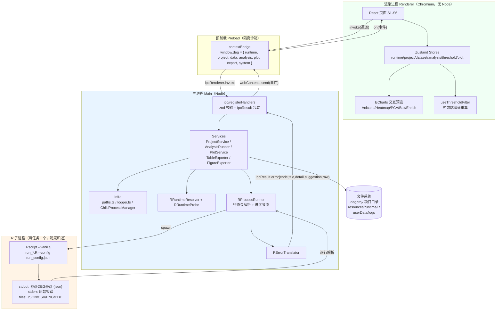
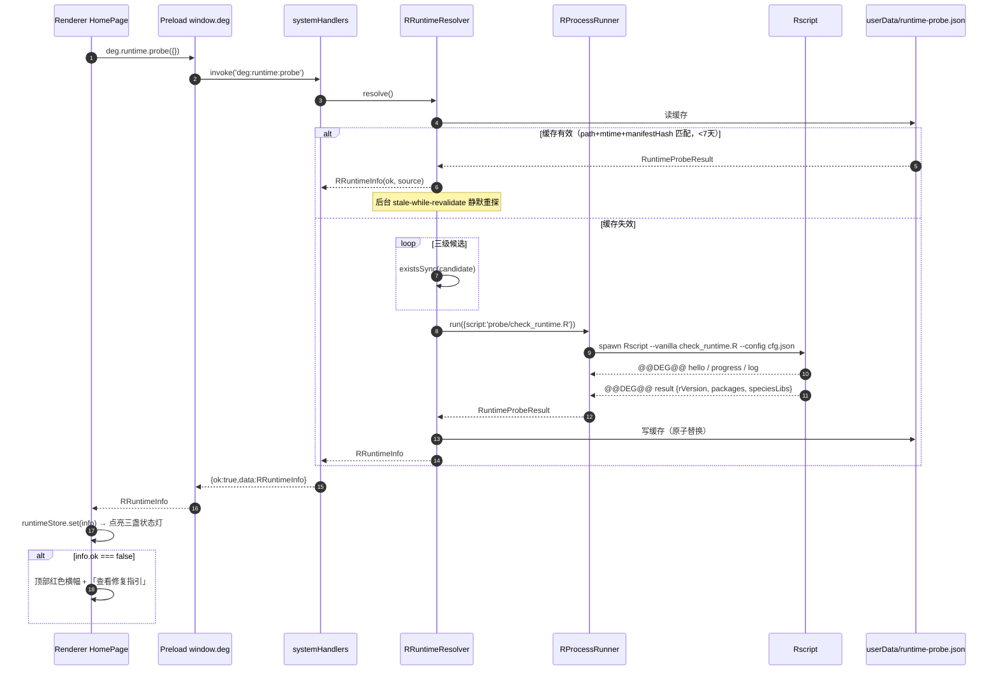
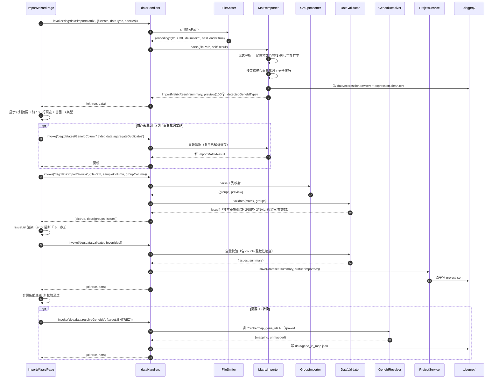
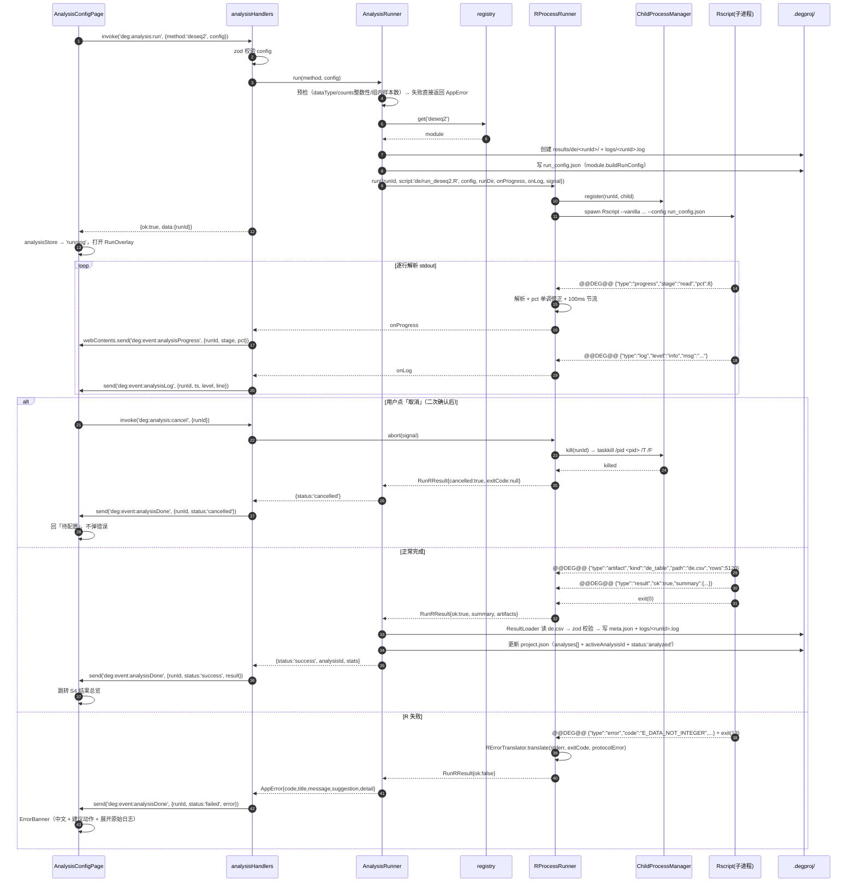
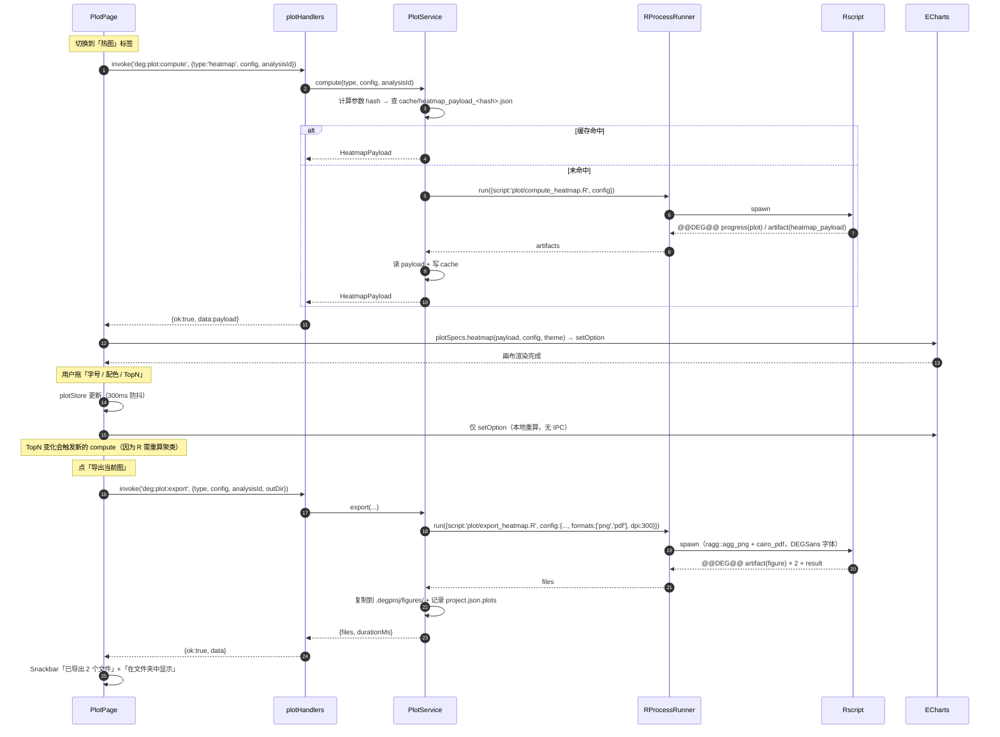
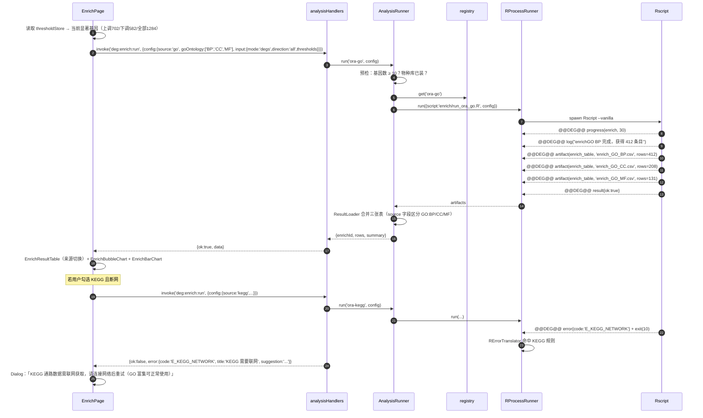

# 系统架构设计 · DEG Studio（`deg_studio` v1.0）

> 撰写：架构师 高见远 ｜ 上游输入：`docs/PRD.md`（PM 许清楚）
> 面向对象：开发工程师（施工依据）、测试（验收依据）
> 状态：**待评审 → 定稿即可施工**

---

## 0. 决策摘要（先看这 8 条）

| # | 决策 | 结论 | 详见 |
|---|---|---|---|
| D1 | 应用框架 | **Electron 30 + electron-vite 2 + React 18 + TypeScript 5**，`contextIsolation: true` / `nodeIntegration: false` | §1 |
| D2 | UI | **MUI 5**（组件）+ **Tailwind 3**（布局工具类，`preflight: false` 避免与 MUI 冲突） | §1 |
| D3 | R 内核调用方式 | **`spawn` 子进程 + `Rscript --vanilla`**，参数全部走 JSON 配置文件，禁止命令行拼长参数 | §5、§6.2 |
| D4 | R 运行时 | **`RRuntimeResolver` 三级探测**（打包便携版 → 开发目录 → 系统 PATH），探测结果缓存 + 能力自检 | §6.1 |
| D5 | 通信协议 | **stdout 单行 JSON 行协议（前缀 `@@DEG@@ `）+ `events.jsonl` 双通道兜底** | §5 |
| D6 | 图表 | **双实现：前端 ECharts 交互预览 + R/ggplot2 导出成品图**；共享 `plotTheme.json` 主题契约；热图聚类由 R 计算后回传 | §6.8 |
| D7 | 阈值联动 | **结果表全量驻留渲染进程内存，纯前端重算**（5000×8 ≈ 1.25 MB，重算 < 3 ms，结论：完全可行） | §6.7 |
| D8 | 分析可插拔 | **`AnalysisModule` 注册表**：加一个分析类型 = 1 个 `.R` 脚本 + 1 个 `modules/xxx.ts` 注册项 + 一份 `formSchema`，核心调度零改动（GSEA 即按此接入） | §6.9 |

**GSEA**：v1.0 不实现（PRD Q2 已确认），但 `r/gsea/` 目录、`registry` 的 `category: 'gsea'`、前端 `formSchema` 通用表单渲染器全部预留，v1.1 只增不改。

---

## 1. 技术选型与理由

### 1.1 选型表

| 层 | 选型 | 版本 | 理由 |
|---|---|---|---|
| 桌面壳 | **Electron** | `^30.1.2` | 客户认可基调；能 `spawn` 子进程、能读本地大文件、能打包 1.5–2.5 GB 资源（Tauri 的 WebView2 在 Win10 老机器上字体/渲染差异更大，且 Rust 团队成本高） |
| 构建 | **electron-vite** | `^2.3.0` | 一份配置同时产出 main / preload / renderer 三份 bundle，自动处理 `externalizeDeps`（Node 原生模块不进 renderer），比手搓 3 个 vite.config 稳定得多 |
| 打包 | **electron-builder** | `^24.13.3` | `extraResources` 精确控制 R 运行时落点；NSIS 安装包可写「本软件含 2GB R 环境」提示页；支持 `asarUnpack` |
| 前端框架 | **React** | `^18.3.1` | 生态 + MUI 成熟度 |
| 类型 | **TypeScript** | `^5.5.2` | 主/渲染共享 `src/shared/types`，IPC 两侧同源类型，杜绝「字段名对不上」这类最高频 bug |
| 组件库 | **MUI** | `^5.15.20` | 表格、对话框、滑块、步骤条开箱即用；中文排版稳定 |
| 样式 | **Tailwind CSS** | `^3.4.4` | 只做布局/间距/栅格；`corePlugins.preflight = false` 关闭全局 reset，避免破坏 MUI 基线样式 |
| 状态 | **Zustand** | `^4.5.4` | 比 Redux 轻，比 Context 性能好（阈值滑块高频更新不能触发全树重渲染） |
| 表格 | **@tanstack/react-table + react-virtual** | `^8.17` / `^3.5` | 5000+ 行虚拟滚动 + 排序 + 搜索，MUI DataGrid 社区版不支持虚拟化大表 |
| 图表 | **ECharts** | `^5.5.0` | 散点 5000 点流畅（canvas）、热图内置、中文渲染无坑；Plotly 包体更大且 3D 不需要 |
| CSV | **papaparse** | `^5.4.1` | 流式解析 + 错误行定位（PRD R-06 要精确到行/列） |
| Excel 读 | **xlsx (SheetJS)** | `^0.18.5` | 支持 .xls/.xlsx 双格式 |
| Excel 写 | **exceljs** | `^4.4.0` | 写入带列宽/冻结首行，中文不乱码（SheetJS 写样式需商业版） |
| 编码探测 | **chardet** + **iconv-lite** | `^2.0.0` / `^0.6.3` | PRD §8.1 要求 UTF-8 → GB18030 回退 |
| 校验 | **zod** | `^3.23.8` | `project.json` / R 配置文件 / IPC 入参三重校验 |
| 设置持久化 | **electron-store** | `^8.2.0` | 最近项目列表、上次目录、窗口尺寸 |
| 测试 | **vitest** + **@testing-library/react** + **playwright** | — | 单测 + Electron E2E |

> **不引入**：`rpy2`/`reticulate`（嵌入 R 会与 Electron 的 Node ABI 打架）、`electron-redux`、`sqlite`（项目数据是文件树，不需要 DB）。

### 1.2 核心架构模式

- **分层**：`renderer（纯 UI）` → `preload（白名单桥）` → `main（全部 Node 能力）` → `R 子进程（纯计算）`。渲染进程**永远不碰 `fs`/`child_process`**。
- **主进程内**再分层：`ipc handlers（薄）` → `services（业务）` → `infra（paths/logger/process）`。
- **单向数据流**：渲染进程通过 `invoke` 请求，通过 `on` 订阅事件；主进程不主动「命令」UI。
- **R 侧无状态**：每个分析都是「新进程 + 完整 JSON 输入 + 文件输出」，跑完即退。**不做常驻 R 进程池**（v1.0 单用户单任务，常驻池带来的内存泄漏与取消复杂度不值得）。

---

## 2. 目录结构（精确到文件，工程师照此建）

```
deg_studio/
├─ package.json                          # 依赖 + scripts（dev/build/dist/test）
├─ electron.vite.config.ts               # main/preload/renderer 三段构建配置
├─ electron-builder.yml                  # 打包配置：extraResources / NSIS / asar
├─ tsconfig.json                          # 根配置（references）
├─ tsconfig.node.json                     # main + preload（Node 环境）
├─ tsconfig.web.json                      # renderer（DOM 环境）
├─ tailwind.config.js                     # preflight:false，content 指向 renderer
├─ postcss.config.js
├─ .eslintrc.cjs
├─ .gitignore                             # 忽略 resources/runtime/R、dist、out
│
├─ build/                                 # 打包用静态资源
│  ├─ icon.ico
│  └─ installer.nsh                       # NSIS 自定义页：告知安装体积 2GB+
│
├─ scripts/                               # 构建期 Node 脚本（不参与运行）
│  ├─ assemble-r-runtime.mjs              # ★ 运行时装配：把用户提供的 R 便携版 + R 包拷入 resources/runtime
│  ├─ verify-r-runtime.mjs                # 校验 Rscript 存在、包齐全、字体存在，输出报告
│  ├─ gen-r-libs-manifest.mjs             # 扫描已装 R 包生成 r-libs-manifest.json
│  └─ gen-demo-data.mjs                   # 生成 24 样本 demo 数据集（可复现随机种子）
│
├─ resources/                             # 会被 extraResources 打进安装包
│  ├─ runtime/
│  │  ├─ R/                               # ★ 便携版 R 放置点（.gitignore，不入库）
│  │  │  └─ .gitkeep
│  │  ├─ R-libs/                          # 便携版 R 的 site-library（R 包实体）
│  │  │  └─ .gitkeep
│  │  └─ fonts/
│  │     ├─ NotoSansSC-Regular.otf        # ★ 内置中文字体（保证 R-30 跨机器不乱码）
│  │     └─ NotoSansSC-Bold.otf
│  ├─ demo/
│  │  ├─ expression.csv                   # 24 样本 × 2000 基因示例 counts
│  │  └─ groups.csv
│  ├─ r-libs-manifest.json                # 必需 R 包清单 + 版本 + 用途（供自检与诊断）
│  └─ plotTheme.json                      # ★ 图表主题契约（配色/字号/尺寸），前端与 R 共用
│
├─ r/                                     # R 脚本源码（构建时整体拷到 resources/r）
│  ├─ common/
│  │  ├─ bootstrap.R                      # ★ 每个脚本第一行 source：环境初始化/UTF-8/字体/错误包裹/退出码
│  │  ├─ protocol.R                       # emit_log / emit_progress / emit_artifact / emit_result / emit_error
│  │  ├─ io.R                             # 读 --config JSON、写 JSON/CSV、原子写入
│  │  ├─ fonts.R                          # 注册 DEGSans（showtext + 内置 Noto 字体）
│  │  ├─ theme.R                          # ggplot2 主题，读 plotTheme.json
│  │  └─ validate.R                       # 入参校验（物种/方法/对比组合法性）
│  ├─ probe/
│  │  ├─ check_runtime.R                  # 能力自检：R 版本 + 必需包 + 物种库 + 字体
│  │  └─ map_gene_ids.R                   # SYMBOL/ENSEMBL/ENTREZ 识别与互转（AnnotationDbi）
│  ├─ de/
│  │  ├─ run_limma_voom.R                 # counts → voom → lmFit → eBayes → topTable
│  │  ├─ run_limma_norm.R                 # 已归一化 → lmFit → eBayes → topTable
│  │  └─ run_deseq2.R                     # DESeqDataSetFromMatrix → DESeq → results
│  ├─ enrich/
│  │  ├─ run_ora_go.R                     # enrichGO（BP/CC/MF 可多选）
│  │  └─ run_ora_kegg.R                   # enrichKEGG（需联网，含网络预检）
│  ├─ plot/
│  │  ├─ compute_pca.R                    # 计算 PCA 坐标 + 方差解释比例（前端渲染用）
│  │  ├─ compute_heatmap.R                # Top N 差异基因 z-score + 行/列聚类排序（前端渲染用）
│  │  ├─ export_volcano.R                 # 火山图 PNG/PDF 导出
│  │  ├─ export_heatmap.R                 # 热图导出
│  │  ├─ export_pca.R                     # PCA 导出
│  │  ├─ export_boxplot.R                 # 箱线图导出
│  │  └─ export_enrich.R                  # 气泡图 + 条形图导出
│  └─ gsea/
│     └─ README.md                        # v1.1 扩展点占位（说明如何加 run_gsea.R）
│
├─ src/
│  ├─ shared/                             # ★ 主进程与渲染进程共享（不得 import electron / node 模块）
│  │  ├─ types/
│  │  │  ├─ project.ts                    # ProjectMeta / AnalysisSnapshot / EnrichSnapshot
│  │  │  ├─ dataset.ts                    # DatasetSummary / Issue / GeneIdType / ImportResult
│  │  │  ├─ analysis.ts                   # DEConfig / DEResultRow / DEStats / AnalysisModuleId
│  │  │  ├─ enrich.ts                     # EnrichConfig / EnrichResultRow / EnrichRunSummary
│  │  │  ├─ plot.ts                       # PlotConfig 联合类型 / PlotPayload 各类型
│  │  │  ├─ runtime.ts                    # RRuntimeInfo / RuntimeProbeResult
│  │  │  └─ ipc-contract.ts               # 每个 channel 的入参/出参类型映射（IpcInvokeMap）
│  │  ├─ ipc.ts                           # 通道名常量（唯一真源）
│  │  ├─ errors.ts                        # 错误码枚举 + 中文标题/建议动作文案
│  │  ├─ protocol.ts                      # R 行协议消息类型 + 解析器（纯函数，两侧可测）
│  │  └─ constants.ts                     # 阶段枚举、图表类型、物种、文件后缀等常量
│  │
│  ├─ main/
│  │  ├─ index.ts                         # app 生命周期、单实例锁、before-quit 清理子进程
│  │  ├─ window.ts                        # BrowserWindow 创建 + 安全策略（CSP / webSecurity）
│  │  ├─ menu.ts                          # 应用菜单（打开项目/导出日志/开发者工具）
│  │  ├─ paths.ts                         # ★★ 全部路径解析集中于此（开发期 vs 打包后）
│  │  ├─ logger.ts                        # 主进程日志（userData/logs/main-YYYYMMDD.log）+ 环形缓冲
│  │  ├─ runtime/
│  │  │  ├─ RRuntimeResolver.ts           # ★ 三级探测 + 版本校验 + 缓存
│  │  │  ├─ RRuntimeProbe.ts              # 调 check_runtime.R 解析能力自检结果
│  │  │  └─ rPackageManifest.ts           # 读 resources/r-libs-manifest.json
│  │  ├─ process/
│  │  │  ├─ RProcessRunner.ts             # ★ spawn + 行协议解析 + 进度节流 + 超时
│  │  │  ├─ ChildProcessManager.ts        # ★ 全局子进程注册表 + killTree（Windows taskkill /T /F）
│  │  │  └─ RErrorTranslator.ts           # ★ stderr → 中文错误码/提示/建议
│  │  ├─ project/
│  │  │  ├─ ProjectService.ts             # 新建/打开/保存/关闭、目录结构创建
│  │  │  ├─ ProjectSchema.ts              # zod schema（project.json 校验 + 迁移）
│  │  │  ├─ ProjectStore.ts               # 内存中的当前项目状态（唯一真源，落盘由 Service 负责）
│  │  │  └─ RecentProjectsStore.ts        # electron-store 最近项目
│  │  ├─ data/
│  │  │  ├─ FileSniffer.ts                # 编码（chardet）+ 分隔符 + 表头嗅探
│  │  │  ├─ MatrixImporter.ts             # 表达矩阵解析 → 清洗 → 落盘 data/expression.clean.csv
│  │  │  ├─ GroupImporter.ts              # 分组表解析 + 列映射
│  │  │  ├─ DataValidator.ts              # R-06 全部校验规则 + Issue[] 产出
│  │  │  └─ GeneIdResolver.ts             # 调 map_gene_ids.R，缓存 ID 映射表
│  │  ├─ analysis/
│  │  │  ├─ registry.ts                   # ★★ 分析模块注册表（GSEA 扩展点）
│  │  │  ├─ modules/
│  │  │  │  ├─ limmaVoom.ts
│  │  │  │  ├─ limmaNorm.ts
│  │  │  │  ├─ deseq2.ts
│  │  │  │  ├─ oraGo.ts
│  │  │  │  └─ oraKegg.ts
│  │  │  ├─ AnalysisRunner.ts             # 统一调度：预检 → 建 run 目录 → 调 R → 加载结果 → 落 project.json
│  │  │  └─ ResultLoader.ts               # 产物读取 + zod 校验 + 类型转换
│  │  ├─ plot/
│  │  │  ├─ PlotService.ts                # compute（拿 payload 给前端）/ export（调 R 出图）
│  │  │  └─ PlotTheme.ts                  # 读写 resources/plotTheme.json
│  │  ├─ export/
│  │  │  ├─ TableExporter.ts              # CSV（UTF-8 BOM）/ Excel（exceljs）
│  │  │  └─ FigureExporter.ts             # 单图/批量导出编排 + 文件名规则
│  │  └─ ipc/
│  │     ├─ registerHandlers.ts           # 统一注册 + zod 入参校验 + 异常转 IpcResult
│  │     ├─ systemHandlers.ts             # runtime:probe / dialog / shell / appInfo
│  │     ├─ projectHandlers.ts
│  │     ├─ dataHandlers.ts
│  │     ├─ analysisHandlers.ts
│  │     └─ plotHandlers.ts
│  │
│  ├─ preload/
│  │  └─ index.ts                         # contextBridge 暴露 window.deg（白名单 API，类型来自 shared）
│  │
│  └─ renderer/
│     ├─ index.html
│     └─ src/
│        ├─ main.tsx                      # ReactDOM.createRoot + ThemeProvider + Router
│        ├─ App.tsx                       # AppShell + 路由出口
│        ├─ router.tsx                    # 6 个页面路由
│        ├─ theme.ts                      # MUI 主题（中文优先字体栈、主色）
│        ├─ index.css                     # tailwind 三件套
│        ├─ store/
│        │  ├─ runtimeStore.ts            # 运行时状态灯
│        │  ├─ projectStore.ts            # 当前项目 + project.json 镜像
│        │  ├─ datasetStore.ts            # 矩阵元信息 + 预览 + 全量表达数据
│        │  ├─ analysisStore.ts           # 运行状态机 + 进度 + 日志环形缓冲
│        │  ├─ thresholdStore.ts          # ★ logFC/FDR 阈值（高频，独立 store 防全局重渲染）
│        │  └─ plotStore.ts               # 各图表 PlotConfig + 当前 payload
│        ├─ pages/
│        │  ├─ HomePage.tsx               # S1
│        │  ├─ ImportWizardPage.tsx       # S2（三步）
│        │  ├─ AnalysisConfigPage.tsx     # S3
│        │  ├─ ResultPage.tsx             # S4
│        │  ├─ PlotPage.tsx               # S5
│        │  └─ EnrichPage.tsx             # S6
│        ├─ components/
│        │  ├─ layout/{AppShell,StepBar,StatusBar}.tsx
│        │  ├─ runtime/{RuntimeStatusLights,DiagnosticsDialog}.tsx
│        │  ├─ common/{DropZone,DataTable,ThresholdSlider,IssueList,ErrorBanner,EmptyState,ConfirmDialog}.tsx
│        │  ├─ run/{RunOverlay,LogPanel,StageProgress}.tsx
│        │  ├─ import/{MatrixPreview,DataTypeSelector,GeneIdPanel,DuplicateStrategyDialog,GroupMappingForm}.tsx
│        │  ├─ analysis/{MethodSelector,ContrastSelector,FilterConfig,PreflightCheckList}.tsx
│        │  ├─ result/{StatCards,ResultTable,ResultToolbar}.tsx
│        │  ├─ charts/{ChartHost,VolcanoChart,HeatmapChart,PcaChart,BoxplotChart,EnrichBubbleChart,EnrichBarChart}.tsx
│        │  ├─ charts/plotTheme.ts        # 前端主题（从 main 拉 plotTheme.json，或本地默认）
│        │  ├─ plot/{PlotParamPanel,PlotTypeTabs,ExportDialog}.tsx
│        │  └─ enrich/{EnrichInputPanel,EnrichResultTable}.tsx
│        ├─ hooks/
│        │  ├─ useAnalysisRun.ts          # 订阅进度/日志事件、驱动状态机
│        │  ├─ useThresholdFilter.ts      # ★ 纯前端阈值重算（useMemo）
│        │  └─ useIpcEvent.ts             # 泛型事件订阅 + 自动解绑
│        └─ utils/
│           ├─ formatting.ts              # 科学计数法/千分位/耗时
│           └─ plotSpecs.ts               # PlotConfig + 数据 → ECharts option 的纯函数（可单测）
│
└─ docs/
   ├─ PRD.md
   ├─ ARCHITECTURE.md                     # 本文档
   ├─ class-diagram.mermaid
   └─ sequence-diagram.mermaid
```

> **`r/` 与 `resources/` 的区别**：`r/` 是源码（可读、可 diff）；`resources/` 是构建产物/二进制。`electron-builder.yml` 里 `from: r, to: r` 把 `r/` 整体拷到 `resources/r`，运行时统一从 `getRScriptsRoot()` 读。**R 脚本绝对不能进 asar**（`spawn` 无法执行 asar 内文件，这是 Electron 头号坑）。

---

## 3. 进程与模块架构图



**IPC 边界铁律**

1. 渲染进程只能访问 `window.deg.*`，`window` 上不存在 `require`/`process`/`fs`。
2. 所有 `invoke` 返回统一信封 `IpcResult<T> = { ok: true; data: T } | { ok: false; error: AppError }`，**永不 throw 到渲染进程**（避免 Electron 把 Error 序列化成 `Error: ...` 字符串丢掉结构）。
3. 所有长任务事件走 `webContents.send`，通道名 `deg:event:*`，事件带 `runId`，渲染进程按 `runId` 丢弃过期事件（防串台）。
4. 主进程 `before-quit` 必须 `ChildProcessManager.killAll()` 并 `await` 完成，否则 Windows 上会残留 `Rscript.exe`。

---

## 4. 核心数据结构与接口（TypeScript）

> 全部定义在 `src/shared/types/*`，主进程与渲染进程同源 import。时间一律 **ISO 8601 UTC 字符串**。

### 4.1 项目

```ts
// src/shared/types/project.ts
export type Species = 'human' | 'mouse';
export type DataType = 'counts' | 'normalized';
export type ProjectStatus = 'imported' | 'analyzed' | 'interrupted' | 'enriched';
export type AnalysisMethodId =
  | 'limma-voom' | 'limma-lm' | 'deseq2'
  | 'ora-go' | 'ora-kegg'
  | 'gsea-go' | 'gsea-kegg';        // ← 后两个 v1.0 不实现，仅类型预留

export interface ProjectMeta {
  schemaVersion: 1;                 // 迁移用；不匹配时 ProjectSchema 走 migrate()
  projectId: string;                // crypto.randomUUID()
  name: string;
  species: Species;
  createdAt: string;
  updatedAt: string;
  appVersion: string;               // 写入时的软件版本
  status: ProjectStatus;
  dataType: DataType;
  dataset?: DatasetSummary;         // 未导入数据时为 undefined
  analyses: AnalysisSnapshot[];     // 历史分析快照（v1.0 只用最后一个，结构支持 P1-09 对比）
  activeAnalysisId?: string;
  enrichRuns: EnrichSnapshot[];
  plots: Partial<Record<PlotType, PlotConfig>>;  // ★ 图表参数快照，重开还原
  lastRun?: { runId: string; startedAt: string; finishedAt?: string; status: RunStatus };
}

export type RunStatus = 'running' | 'success' | 'failed' | 'cancelled';

export interface AnalysisSnapshot {
  id: string;
  method: AnalysisMethodId;
  label: string;                    // "DESeq2 · Tumor vs Normal"
  config: DEConfig;                 // ★ 完整参数快照
  resultPath: string;               // 相对项目根，如 results/de/20250612-1022-de.csv
  stats: DEStats;
  thresholds: { logFC: number; fdr: number };   // 上次使用的阈值
  durationMs: number;
  createdAt: string;
  rLogPath: string;                 // logs/<runId>.log
}

export interface EnrichSnapshot {
  id: string;
  source: 'go' | 'kegg';
  config: EnrichConfig;
  resultPath: string;
  summary: { termCount: number; geneCount: number; durationMs: number };
  createdAt: string;
  rLogPath: string;
}
```

### 4.2 数据集

```ts
// src/shared/types/dataset.ts
export type GeneIdType = 'SYMBOL' | 'ENSEMBL' | 'ENTREZ' | 'UNKNOWN';
export type DuplicateStrategy = 'mean' | 'sum' | 'max' | 'first';
export type IssueLevel = 'error' | 'warning' | 'info';

export interface Issue {
  code: string;                     // 对应 errors.ts 的错误码
  level: IssueLevel;
  message: string;                  // 中文人话
  suggestion?: string;              // 建议动作
  locator?: { row?: number; column?: string; sample?: string; gene?: string };
  count?: number;                   // 同类问题聚合数量
  samples?: string[];               // 差集清单（最多列 20 个）
}

export interface DatasetSummary {
  matrixSourceFile: string;         // 用户原始文件名（仅展示）
  matrixPath: string;               // 项目内副本 data/expression.clean.csv（相对路径）
  rawMatrixPath: string;            // data/expression.raw.csv
  encoding: 'utf-8' | 'gb18030';
  delimiter: ',' | '\t' | ';';
  geneIdColumn: string;             // 基因 ID 列名
  geneIdType: GeneIdType;
  duplicateStrategy: DuplicateStrategy;
  geneCount: number;                // 清洗后基因数
  sampleCount: number;
  samples: string[];                // 顺序即矩阵列顺序
  groupColumn: string;              // 分组列名（默认 'group'）
  sampleColumn: string;             // 样本列名（默认 'sample'）
  groups: Record<string, string[]>; // { Tumor: ['S01',...], Normal: [...] }
  naRatio: number;                  // 0..1
  allZeroGeneCount: number;
  issues: Issue[];
  hasBlockingIssue: boolean;        // 任一 level==='error'
}

export interface ImportMatrixResult {
  summary: DatasetSummary;
  preview: { columns: string[]; rows: (string | number)[][] };   // 前 100 行
  detectedGeneIdType: GeneIdType;
  geneIdSample: string[];           // 前 5 个基因 ID，供用户确认
}

/** 渲染进程持有的全量表达数据（供箱线图/PCA 兜底渲染） */
export interface ExpressionPayload {
  geneIds: string[];
  geneNames: string[];
  samples: string[];
  /** 行优先扁平数组：values[g * sampleCount + s] */
  values: Float64Array | number[];
  naMask?: Uint8Array;              // 1 = 该位置为 NA
}
```

### 4.3 差异分析

```ts
// src/shared/types/analysis.ts
export interface DEConfig {
  method: Extract<AnalysisMethodId, 'limma-voom' | 'limma-lm' | 'deseq2'>;
  dataType: DataType;
  contrast: {
    groupColumn: string;
    numerator: string;              // 实验组（logFC > 0 表示在此组上调）
    denominator: string;            // 对照（基线）
  };
  filter: {
    enabled: boolean;
    mode: 'filterByExpr' | 'custom';
    minCount?: number;              // custom: 表达量 ≥ minCount
    minSamplesPct?: number;         // custom: 在 ≥ N% 样本中检出
  };
  fdrMethod: 'BH' | 'BY' | 'holm' | 'none';
  outputGeneName: boolean;
  keepAllGenes: boolean;            // 不过滤（与 filter.enabled 互斥，UI 需联动）
}

export interface DEResultRow {
  geneId: string;
  geneName: string | null;
  logFC: number;
  aveExpr: number;                  // DESeq2 用 baseMean
  t: number;                        // DESeq2 用 stat
  pValue: number;
  adjPValue: number;
  b: number | null;                 // DESeq2 无 B，置 null
  regulation: 'up' | 'down' | 'ns'; // 注意：与阈值无关，按 logFC 符号 + adjP 判定的「默认标注」由前端重算
}

export interface DEStats {
  totalGenesAfterFilter: number;
  upCount: number;                  // 按 thresholds 计算
  downCount: number;
  nsCount: number;
  filteredOutCount: number;
}

/** 结果页阈值（纯前端状态，不落 R 配置） */
export interface ThresholdState { logFC: number; fdr: number }
```

> **`regulation` 语义澄清**：R 输出的 `regulation` 只是「logFC 符号 + p<0.05」的粗标注；**界面上的上调/下调/不显著一律由前端按当前阈值重算**，保证 R-15「火山图显著点数 == 结果表行数」严格相等。

### 4.4 富集

```ts
// src/shared/types/enrich.ts
export interface EnrichConfig {
  source: 'go' | 'kegg';
  species: Species;
  goOntology: ('BP' | 'CC' | 'MF')[];        // 仅 GO 有效
  input: {
    mode: 'degs' | 'manual' | 'gmt';
    direction: 'all' | 'up' | 'down';         // 从差异结果取子集
    geneList?: string[];                      // mode==='manual'
    gmtPath?: string;                         // mode==='gmt'（P1）
    thresholds: ThresholdState;               // 快照：用哪套阈值挑基因
  };
  pAdjustMethod: 'BH' | 'BY' | 'holm' | 'none';
  pvalueCutoff: number;
  qvalueCutoff: number;
  minGSSize: number;
  maxGSSize: number;
  readable: boolean;                          // 是否把 ENTREZ 转回 SYMBOL
}

export interface EnrichResultRow {
  id: string;              // GO:0007049 / hsa04110
  description: string;
  geneRatio: string;       // "42/1284"
  bgRatio: string;         // "1284/18800"
  pvalue: number;
  pAdjust: number;
  qvalue: number;
  geneId: string;          // "/" 分隔
  count: number;
  source: 'GO:BP' | 'GO:CC' | 'GO:MF' | 'KEGG';
}
```

### 4.5 图表

```ts
// src/shared/types/plot.ts
export type PlotType = 'volcano' | 'heatmap' | 'pca' | 'boxplot' | 'enrich-bubble' | 'enrich-bar';

export interface PlotBaseConfig {
  type: PlotType;
  title: string;
  palette: string;          // 主题名，如 'red-blue' | 'viridis' | 'set2'
  fontSize: number;
  widthIn: number;          // 英寸
  heightIn: number;
  dpi: number;              // 默认 300
  formats: ('png' | 'pdf')[];
  showGeneLabels: boolean;
}

export interface VolcanoConfig extends PlotBaseConfig {
  type: 'volcano';
  logFC: number; fdr: number;
  topN: number;             // 标注 Top N
  pointSize: number;
}

export interface HeatmapConfig extends PlotBaseConfig {
  type: 'heatmap';
  topN: number;             // 默认 50
  zScore: boolean;          // 默认 true
  clusterRows: boolean;
  clusterCols: boolean;
  clusterMethod: 'complete' | 'average' | 'ward.D2' | 'single';
  distance: 'euclidean' | 'correlation' | 'manhattan';
  showGroupAnnotation: boolean;
}

export interface PcaConfig extends PlotBaseConfig {
  type: 'pca';
  topVariableGenes: number; // 默认 500
  pcX: 1; pcY: 2;           // 1..5
  showEllipse: boolean;
  logTransform: boolean;
}

export interface BoxplotConfig extends PlotBaseConfig {
  type: 'boxplot';
  mode: 'gene' | 'qc';
  genes: string[];          // mode==='gene'
  overlayPoints: boolean;
  logAxis: boolean;
}

export interface EnrichPlotConfig extends PlotBaseConfig {
  type: 'enrich-bubble' | 'enrich-bar';
  source: 'GO:BP' | 'GO:CC' | 'GO:MF' | 'KEGG';
  topN: number;             // 默认 20
  orderBy: 'p.adjust' | 'count';
  sizeByCount: boolean;
  colorByPAdjust: boolean;
}

export type PlotConfig = VolcanoConfig | HeatmapConfig | PcaConfig | BoxplotConfig | EnrichPlotConfig;

/** 前端渲染所需的数据载荷（R compute_* 产出，或前端本地构造） */
export interface PcaPayload {
  varianceExplained: number[];              // [42.3, 18.1, ...]
  points: { sample: string; group: string; pc: number[] }[];
}
export interface HeatmapPayload {
  genes: string[]; samples: string[];
  rowOrder: number[]; colOrder: number[];   // ★ 聚类顺序由 R 给出，保证预览与导出完全一致
  values: number[][];                       // z-score 后矩阵（已按 rowOrder/colOrder 排好）
  groups: Record<string, string>;           // sample -> group
}
export interface BoxplotPayload {
  gene: string;
  groups: string[];
  values: { group: string; sample: string; value: number }[];
}
```

### 4.6 R 运行时

```ts
// src/shared/types/runtime.ts
export type RuntimeSource = 'bundled' | 'system';

export interface RPackageStatus { name: string; version: string | null; ok: boolean; required: boolean }

export interface RRuntimeInfo {
  ok: boolean;                      // 可运行（R 存在 + 版本达标 + 必需包齐全）
  source: RuntimeSource;
  rscriptPath: string;              // 绝对路径
  rHome: string | null;
  version: string;                  // "4.3.2"
  arch: string;                     // "x86_64-w64-mingw32"
  libPaths: string[];
  packages: RPackageStatus[];
  missingPackages: string[];
  speciesLibs: { human: boolean; mouse: boolean };
  fontAvailable: boolean;           // 中文出图字体
  probedAt: string;
  warnings: string[];
}

export interface RuntimeProbeResult {
  rVersion: string; rArch: string; platform: string;
  packages: RPackageStatus[];
  speciesLibs: { human: boolean; mouse: boolean };
  fontFamilies: string[];
}
```

### 4.7 IPC 通道常量表（`src/shared/ipc.ts`）

命名规则：`deg:<domain>:<action>`，全部 **camelCase action**，事件统一前缀 `deg:event:`。

| 常量 | 字符串 | 方向 | 入参 → 出参 |
|---|---|---|---|
| `IPC.runtime.probe` | `deg:runtime:probe` | invoke | `{ force?: boolean }` → `RRuntimeInfo` |
| `IPC.runtime.diagnostics` | `deg:runtime:diagnostics` | invoke | `void` → `{ runtime: RRuntimeInfo; report: string }` |
| `IPC.system.pickFile` | `deg:system:pickFile` | invoke | `{ filters; multi? }` → `string[]` |
| `IPC.system.pickDir` | `deg:system:pickDir` | invoke | `void` → `string \| null` |
| `IPC.system.saveFile` | `deg:system:saveFile` | invoke | `{ defaultName; filters }` → `string \| null` |
| `IPC.system.revealPath` | `deg:system:revealPath` | invoke | `{ path }` → `void` |
| `IPC.system.appInfo` | `deg:system:appInfo` | invoke | `void` → `{ version; electron; node; chrome; resourcesRoot }` |
| `IPC.project.create` | `deg:project:create` | invoke | `{ name; species; parentDir }` → `ProjectMeta` |
| `IPC.project.open` | `deg:project:open` | invoke | `{ dir }` → `{ meta; dataset?; expression? }` |
| `IPC.project.save` | `deg:project:save` | invoke | `{ patch: Partial<ProjectMeta> }` → `ProjectMeta` |
| `IPC.project.close` | `deg:project:close` | invoke | `void` → `void` |
| `IPC.project.recent` | `deg:project:recent` | invoke | `void` → `RecentProject[]` |
| `IPC.project.loadDemo` | `deg:project:loadDemo` | invoke | `{ parentDir }` → `ProjectMeta` |
| `IPC.data.importMatrix` | `deg:data:importMatrix` | invoke | `{ filePath; dataType; species; geneIdColumn?; duplicateStrategy? }` → `ImportMatrixResult` |
| `IPC.data.importGroups` | `deg:data:importGroups` | invoke | `{ filePath; sampleColumn?; groupColumn? }` → `{ groups; issues; preview }` |
| `IPC.data.validate` | `deg:data:validate` | invoke | `{ overrides? }` → `{ issues; summary }` |
| `IPC.data.setGeneIdColumn` | `deg:data:setGeneIdColumn` | invoke | `{ column }` → `ImportMatrixResult` |
| `IPC.data.aggregateDuplicates` | `deg:data:aggregateDuplicates` | invoke | `{ strategy }` → `ImportMatrixResult` |
| `IPC.data.resolveGeneIds` | `deg:data:resolveGeneIds` | invoke | `{ target: GeneIdType }` → `{ mapping: Record<string,string>; unmapped: number }` |
| `IPC.analysis.run` | `deg:analysis:run` | invoke | `{ method; config: DEConfig }` → `{ runId }` |
| `IPC.analysis.cancel` | `deg:analysis:cancel` | invoke | `{ runId }` → `{ killed: boolean }` |
| `IPC.analysis.loadResult` | `deg:analysis:loadResult` | invoke | `{ analysisId }` → `{ rows: DEResultRow[]; stats: DEStats }` |
| `IPC.enrich.run` | `deg:enrich:run` | invoke | `{ config: EnrichConfig }` → `{ runId }` |
| `IPC.enrich.loadResult` | `deg:enrich:loadResult` | invoke | `{ enrichId }` → `EnrichResultRow[]` |
| `IPC.plot.compute` | `deg:plot:compute` | invoke | `{ type; config; analysisId }` → `PlotPayload` |
| `IPC.plot.export` | `deg:plot:export` | invoke | `{ type; config; analysisId; outDir; fileName? }` → `{ files: string[]; durationMs }` |
| `IPC.plot.exportAll` | `deg:plot:exportAll` | invoke | `{ outDir; analysisId }` → `{ files: string[] }` |
| `IPC.export.table` | `deg:export:table` | invoke | `{ kind; format; rows; outPath }` → `{ outPath }` |
| `IPC.export.log` | `deg:export:log` | invoke | `{ runId; outPath }` → `{ outPath }` |
| `IPC.event.analysisProgress` | `deg:event:analysisProgress` | main→renderer | `{ runId; stage; pct; msg }` |
| `IPC.event.analysisLog` | `deg:event:analysisLog` | main→renderer | `{ runId; ts; level; line }` |
| `IPC.event.analysisDone` | `deg:event:analysisDone` | main→renderer | `{ runId; status; result?: unknown; error?: AppError }` |
| `IPC.event.runtimeChanged` | `deg:event:runtimeChanged` | main→renderer | `RRuntimeInfo` |

### 4.8 错误与信封

```ts
// src/shared/errors.ts
export type ErrorCode =
  | 'E_RT_MISSING' | 'E_RT_VERSION' | 'E_RT_PKG_MISSING' | 'E_RT_FONT_MISSING'
  | 'E_DATA_NOT_INTEGER' | 'E_DATA_SAMPLE_MISMATCH' | 'E_DATA_ENCODING'
  | 'E_DATA_GROUP_TOO_FEW' | 'E_DATA_GROUP_TOO_SMALL' | 'E_DATA_DUP_GENE'
  | 'E_DATA_DUP_SAMPLE' | 'E_DATA_EMPTY' | 'E_DATA_NA_RATIO' | 'E_DATA_NON_NUMERIC'
  | 'E_R_MEMORY' | 'E_R_GENEID_MAP' | 'E_KEGG_NETWORK' | 'E_R_GENERIC'
  | 'E_CANCELLED' | 'E_IO_PERMISSION' | 'E_PROJECT_CORRUPT' | 'E_PROJECT_SCHEMA'
  | 'E_VALIDATION' | 'E_UNKNOWN';

export interface AppError {
  code: ErrorCode;
  title: string;          // 一句话：「DESeq2 需要整数 counts」
  message: string;        // 具体说明（含定位信息）
  suggestion?: string;    // 「改用 limma + voom 重试」
  detail?: string;        // 可展开的原始 R stderr（截断到 20k 字符）
  locator?: Issue['locator'];
}

export type IpcResult<T> = { ok: true; data: T } | { ok: false; error: AppError };
```

### 4.9 主进程核心类（接口签名）

```ts
// src/main/runtime/RRuntimeResolver.ts
export class RRuntimeResolver {
  constructor(private runner: RProcessRunner, private paths: PathService) {}
  /** 三级探测 + 缓存；force=true 跳过缓存 */
  async resolve(opts?: { force?: boolean }): Promise<RRuntimeInfo>;
  /** 候选 Rscript 路径，按优先级排列（含存在性标记，供诊断页展示） */
  candidates(): { path: string; source: RuntimeSource; exists: boolean }[];
  /** 能力自检（调 probe/check_runtime.R） */
  async probe(rscriptPath: string): Promise<RuntimeProbeResult>;
  /** 校验版本 >= 4.2.0 */
  private checkVersion(v: string): boolean;
  invalidate(): void;
}

// src/main/process/RProcessRunner.ts
export interface RunROptions {
  runId: string;
  scriptRelPath: string;           // 相对 r/ 根，如 'de/run_deseq2.R'
  config: unknown;                 // 会被写成 run_config.json
  runDir: string;                  // 项目内临时运行目录
  timeoutMs?: number;              // 默认 30 min
  onProgress?(p: ProgressMsg): void;
  onLog?(l: LogMsg): void;
  onArtifact?(a: ArtifactMsg): void;
  signal?: AbortSignal;
}
export interface RunRResult {
  ok: boolean;
  exitCode: number | null;
  summary?: Record<string, unknown>;
  artifacts: ArtifactMsg[];
  stderr: string;
  durationMs: number;
  cancelled: boolean;
}
export class RProcessRunner {
  constructor(private resolver: RRuntimeResolver, private paths: PathService) {}
  async run(opts: RunROptions): Promise<RunRResult>;
}

// src/main/process/ChildProcessManager.ts
export class ChildProcessManager {
  register(runId: string, child: ChildProcess): void;
  async kill(runId: string): Promise<boolean>;   // Windows: taskkill /pid <pid> /T /F
  async killAll(): Promise<void>;                // before-quit 调用
  has(runId: string): boolean;
}

// src/main/analysis/registry.ts
export interface FormFieldSchema {
  key: string;                     // 点路径，如 'filter.minCount'
  label: string;
  type: 'select' | 'number' | 'switch' | 'slider' | 'multiSelect' | 'geneSearch';
  options?: { value: string; label: string; disabledWhen?: Record<string, unknown> }[];
  default?: unknown;
  min?: number; max?: number; step?: number;
  helpText?: string;
  visibleWhen?: Record<string, unknown>;    // 简单条件渲染（浅比较）
}

export interface ArtifactSpec {
  kind: 'de_table' | 'enrich_table' | 'pca_coords' | 'heatmap_payload' | 'figure' | 'log';
  fileName: string;                // 相对 runDir
  format: 'csv' | 'json' | 'png' | 'pdf';
}

export interface AnalysisModule<TConfig = unknown, TRow = unknown> {
  id: AnalysisMethodId;
  label: string;
  category: 'de' | 'enrich' | 'gsea';
  /** 可用性约束：不满足时 UI 置灰并给出 reason（PRD R-10） */
  availability(ctx: AvailabilityContext): { enabled: boolean; reason?: string };
  formSchema: FormFieldSchema[];
  rScript: string;                                  // 相对 r/
  buildRunConfig(config: TConfig, ctx: RunContext): unknown;
  outputs: ArtifactSpec[];
  loadResult(runDir: string): Promise<TRow[]>;
}

export class AnalysisRegistry {
  register<T, R>(m: AnalysisModule<T, R>): void;
  get(id: AnalysisMethodId): AnalysisModule;
  list(category?: 'de' | 'enrich' | 'gsea'): AnalysisModule[];
  /** 前端拉取表单 schema，实现「新分析类型零前端改动」 */
  schemas(): { id: string; label: string; formSchema: FormFieldSchema[] }[];
}
```

---

## 5. R 子进程协议（本项目最易出错处，逐字段定义）

### 5.1 调用形式

```bash
# Windows
"C:\...\resources\runtime\R\bin\Rscript.exe" --vanilla --no-save --no-restore \
  "C:\...\resources\r\de\run_deseq2.R" --config "C:\...\.degproj\results\de\run-abc\run_config.json"

# macOS/Linux
.../Rscript --vanilla --no-save --no-restore .../r/de/run_deseq2.R --config .../run_config.json
```

**规则**

1. **`--vanilla`**：忽略用户 `~/.Rprofile`、`.Renviron`、保存的工作区。否则用户机器上的 `options()` 会污染结果（S3 正确性验收的隐形杀手）。
2. **`--config <path>`**：唯一参数，所有业务参数在 JSON 里。避免 Windows 命令行长度上限（32k）与中文/空格转义问题。
3. **环境变量**（`spawn` 的 `env`，与 `process.env` 合并）：
   - `R_LIBS_SITE = <resources>/runtime/R-libs`
   - `R_LIBS_USER = <userData>/r-libs-user`（可写，放用户自装包）
   - `R_ENCODING = UTF-8`、`LANG = zh_CN.UTF-8`、`LC_ALL = C.UTF-8`
     > ⚠️ **这些 locale 变量在 Windows 上是无效的**：Windows 版 R 不认 `C.UTF-8` 这个名字，`LC_CTYPE` 会静默退回 `C`（ASCII）。**不要靠调 env 来保证中文/UTF-8**——真正的保证来自两处：`r/common/loader.R` 的 locale 无关加载（见 §5.6）+ R 侧 `options(encoding="UTF-8")`。POSIX 上这些变量才真正生效。
   - `TMPDIR = <userData>/tmp`（**不要用系统 TEMP**：中文用户名 + 空格路径会让 R 的 tempdir 出问题）
   - `DEG_FONT_PATH = <resources>/runtime/fonts/NotoSansSC-Regular.otf`
   - `DEG_THEME_PATH = <resources>/plotTheme.json`
4. **`cwd` = `runDir`**：R 侧所有相对路径都相对它，产物不会散落。
5. `stdio: ['ignore', 'pipe', 'pipe']`，`windowsHide: true`（不弹黑窗）。

### 5.2 stdout 行协议

**格式**：`@@DEG@@ ` + **单行紧凑 JSON**（`jsonlite::toJSON(auto_unbox=TRUE, null="null", digits=NA)`）+ `\n`。

- 不以 `@@DEG@@ ` 开头的行 = R 的原始输出（`print`/包消息）→ 以 `level: 'raw'` 进日志环形缓冲，**节流：每秒最多转发 50 行到 UI，超出只计数**。
- 单行长度上限 64 KB；超长消息（如 geneId 列表）**必须**改为「写文件 + 发 artifact 引用」，不得塞进协议行。

**公共字段**

| 字段 | 类型 | 说明 |
|---|---|---|
| `v` | `1` | 协议版本，主进程校验，不匹配直接报 `E_RT_VERSION` |
| `type` | string | 消息类型，见下 |
| `seq` | number | 从 1 单调递增，用于丢包检测（主进程发现跳号则记 warn） |
| `ts` | number | R 侧 `as.numeric(Sys.time())*1000` 取整 |

**消息类型**

| type | 字段 | 示例 |
|---|---|---|
| `hello` | `script`, `rVersion`, `pid` | `@@DEG@@ {"v":1,"type":"hello","seq":1,"ts":1718...,"script":"de/run_deseq2.R","rVersion":"4.3.2","pid":24188}` |
| `log` | `level: debug\|info\|warn\|error`, `msg` | `@@DEG@@ {"v":1,"type":"log","seq":2,"ts":...,"level":"info","msg":"读取表达矩阵 5432 × 48"}` |
| `progress` | `stage`, `pct: 0..100`, `msg?` | `@@DEG@@ {"v":1,"type":"progress","seq":5,"ts":...,"stage":"dispersion","pct":62,"msg":"正在估计离散度"}` |
| `artifact` | `kind`, `path`（相对 runDir）, `rows?`, `schema?` | `@@DEG@@ {"v":1,"type":"artifact","seq":9,"ts":...,"kind":"de_table","path":"de.csv","rows":5432,"schema":"DEResultRow[]"}` |
| `result` | `ok: true`, `summary`（任意对象） | `@@DEG@@ {"v":1,"type":"result","seq":11,"ts":...,"ok":true,"summary":{"genesAfterFilter":5120,"up":702,"down":582,"durationMs":86421}}` |
| `error` | `code`, `message`, `detail?` | `@@DEG@@ {"v":1,"type":"error","seq":10,"ts":...,"code":"E_DATA_NOT_INTEGER","message":"检测到 1284 个非整数值","detail":"first at row 12 col S03"}` |

**stage 枚举（顺序即进度条阶段，PRD R-28）**

```
read → filter → normalize → dispersion → fit → test → enrich → plot → write
```

各阶段建议 pct 区间（R 侧自行上报，主进程只做「不回退」修正：`pct = max(pct, lastPct)`）：

| 方法 | read | filter | normalize | dispersion | fit | test | write |
|---|---|---|---|---|---|---|---|
| limma-voom | 0-15 | 15-25 | 25-45 | — | 45-75 | 75-90 | 90-100 |
| limma-lm | 0-15 | 15-25 | — | — | 25-75 | 75-90 | 90-100 |
| deseq2 | 0-10 | 10-20 | 20-35 | 35-65 | 65-85 | 85-95 | 95-100 |
| ora-go / ora-kegg | 0-30 | 30-70 | — | — | — | 70-90 | 90-100 |
| export_* | 0-40 | — | — | — | — | — | 40-100 |

### 5.3 `events.jsonl` 双通道兜底（关键健壮性设计）

**问题**：Windows 下 R 的 stdout 编码在某些 locale / 非 ASCII 用户目录下会被转成 GBK 或出现乱码，导致 JSON 解析失败——这是「R + Electron」组合最高频的线上事故。

**方案**：`common/protocol.R` 的每个 emit 函数**同时**做两件事：

1. `cat(line, "\n", file=stdout(), sep="")` —— 实时通道；
2. `cat(line, "\n", file=eventsCon, append=TRUE)` —— 其中 `eventsCon` 是 `file(file.path(runDir,"events.jsonl"), open="a", encoding="UTF-8")`，进程结束时关闭。

主进程策略：

- 正常运行：只读 stdout，`events.jsonl` 忽略。
- **兜底触发条件**（任一）：① 进程退出但从未收到 `result`/`error` 消息；② stdout 连续 3 行 JSON 解析失败；③ `exitCode === 0` 但无 artifact。
  → 主进程读 `runDir/events.jsonl`，逐行（UTF-8 强制解码）重放，重建结果。
- 兜底触发时记 `warn` 日志并在「原始日志」里提示「已使用日志文件回退解析」。

### 5.4 stderr 处理

- 逐行收集到内存缓冲（上限 2000 行 / 512 KB，超出丢弃最早的并记 `[truncated]`）。
- **不实时推到 UI**（避免 R warning 刷屏干扰用户），只在「展开原始日志」中展示；但 `level==='error'` 的 stderr 行会立即进日志面板。
- 进程结束后：`stderr 全文 + 最后一条 error 消息 + exitCode` 一起交给 `RErrorTranslator`。

### 5.5 退出码约定

| exitCode | 含义 | 主进程行为 |
|---|---|---|
| `0` | 成功 | 校验 `result` 消息存在，加载 artifacts |
| `10` | R 运行期错误（`stop()`） | 用 stderr 走错误翻译，`E_R_GENERIC` 兜底 |
| `11` | 配置文件非法/缺参数 | `E_VALIDATION` |
| `12` | 缺少 R 包 | `E_RT_PKG_MISSING`，提示运行诊断 |
| `13` | 数据不满足前置条件（如 DESeq2 遇小数） | 按 `error.code` 映射（`E_DATA_NOT_INTEGER` 等） |
| `14` | 产物写入失败 | `E_IO_PERMISSION` |
| `null` + `signal` | 被 kill（取消 / 退出） | `E_CANCELLED`，**不当作失败上报**，UI 回「待配置」 |
| 其他 | 未知 | `E_R_GENERIC` + 保留原始 stderr |

> **本表依赖 §5.6 的两个前提才真正生效**：① 入口脚本必须 `source(loader.R)`（否则 exit 恒为 1、连协议行都没有）；② `deg_main` 里调 `emit_error` **不能传 `ctx`**（否则错误处理器自己先报 `unused argument`，11/12/13/14 全部丢失）。这两条都曾是真 bug，已修，实测：缺 `limma` → exit 12、故意 `stop()` → exit 10。

### 5.6 R 侧统一入口：**两段式**（`loader.R` → `bootstrap.R`）

**入口脚本的固定头（三段，不是两行）**：

```r
.deg_root <- Sys.getenv("DEG_R_ROOT", unset = "")
if (!nzchar(.deg_root)) {          # 回退：从 --file= 反推 <root>/<category>/xxx.R
  .deg_args <- commandArgs(trailingOnly = FALSE)
  .deg_file <- sub("^--file=", "", grep("^--file=", .deg_args, value = TRUE))
  .deg_root <- dirname(dirname(normalizePath(.deg_file, mustWork = FALSE)))
}
source(file.path(.deg_root, "common", "loader.R"))   # ★ 不是 bootstrap.R

deg_main("de/run_deseq2.R", function(ctx) { ... })
```

#### 为什么必须多一层 `loader.R`（真实跑出来的 bug，已修，勿回退）

原设计是 `source(..., "common/bootstrap.R", encoding = "UTF-8")` 一行搞定。**在 Windows + R 4.3.2 上必挂**：

1. `RProcessRunner.buildRenv()` 导出 `LC_ALL=C.UTF-8`；
2. **Windows 版 R 不认 `C.UTF-8` 这个名字**，`LC_CTYPE` 退回 `C`（ASCII）；
3. `source(encoding="UTF-8")` 在解析时要把 UTF-8 **转成 native 编码**，在 ASCII 下遇到第一个中文注释即失败；
4. R **只发一条 warning**（`invalid input found on input connection`），`source()` 半途返回；
5. `deg_main` 从未定义 → `could not find function "deg_main"` → **exit 1**；
6. stdout 零协议行、`events.jsonl` 也没建出来 → 主进程只能落到 `E_R_GENERIC`。

这是最难查的一类故障：**不是 exit 0**（走不到「零退出无产物」的兜底分支）、**没有 `@@DEG@@` 行**（错误码无从翻译）、R 的提示还指向"编码"而真正原因在 locale。

**修法**：`loader.R` 用 `readLines(encoding="UTF-8") + parse(text=, encoding="UTF-8")` 加载源码。`parse(text=)` **不做 native 转换**，因此在 C / GBK / UTF-8 任何 locale 下行为一致。（对照实验：`rawToChar + Encoding<-"UTF-8"` 这条路不行——C locale 下会退化成 `<U+4E2D>` 转义。）

> **`loader.R` 必须保持纯 ASCII**（注释也不行）。它是整条链路第一个被加载的文件，也就是"必须在无法表示中文的 locale 下也能加载成功"的那一个。此禁令写在文件头。

#### `deg_main` 的真实实现（注意 `emit_error` 的签名）

```r
deg_main <- function(scriptName, fn) {
  ctx <- deg_init(scriptName)      # 解析 --config、开 events.jsonl、注册字体
  emit_hello(ctx)
  status <- 0L
  tryCatch(
    fn(ctx),
    deg_error = function(e) {
      # ★ emit_error 签名是 (code, message, detail) —— **没有 ctx**
      emit_error(e$code, e$message, if (is.null(e$detail)) "" else e$detail)
      status <<- if (is.null(e$status)) 10L else as.integer(e$status)
    },
    error = function(e) {
      emit_error("E_R_GENERIC", conditionMessage(e),
                 paste(utils::head(deparse(conditionCall(e)), 5), collapse = " "))
      status <<- 10L
    }
  )
  deg_close(ctx)
  quit(save = "no", status = status, runLast = FALSE)   # 显式退出码
}
```

#### 两条已修的坑（改动前先读这张表）

| 坑 | 后果 | 正确做法 |
|---|---|---|
| `source(..., encoding="UTF-8")` 直接加载 `bootstrap.R` | Windows + `LC_CTYPE=C` 下 source 半途返回：exit 1、零协议行、无 `events.jsonl`，且只有一条 warning | 一律 `source(loader.R)`，由它做 locale 无关加载 |
| `emit_error(ctx, code, message, detail)` 多传 `ctx` | **错误处理器自己先报 `unused argument`**，于是退出码 11/12/13/14 从未到达主进程——§5.5 的表长期处于"写着但没生效"状态 | `emit_error(code, message, detail)`，**无 ctx** |

> **`quit()` 必须显式**：`tryCatch` 里 `stop()` 后若不显式 `quit`，exitCode 可能退化成 1 而非约定值。
> 另注：`bootstrap.R` 里的 `deg_stop(code, message, detail, status)` 是业务侧抛错的唯一入口，`status` 默认 `10L`，需要 11/12/13/14 时显式传。

---

## 6. 关键机制详解

### 6.1 `RRuntimeResolver`：三级探测 + 版本校验 + 能力自检

**探测顺序**（短路，命中即停）

| 级 | 候选路径 | 说明 |
|---|---|---|
| 1 | `<resourcesRoot>/runtime/R/bin/Rscript.exe`（Win）<br/>`<resourcesRoot>/runtime/R/bin/Rscript`（POSIX） | **打包后的生产形态**。`extraResources` 落点。 |
| 2 | `<app.getAppPath()>/resources/runtime/R/bin/Rscript.exe` | **开发期**形态（`app.isPackaged === false`）。注意级 1 在开发期指向 `node_modules/electron/dist/resources`，所以开发期必须走级 2。 |
| 3 | `PATH` 中的 `Rscript` | 开发者本机已装 R 时可用。用 `which`/`where` 探测，Windows 额外扫注册表 `HKLM\SOFTWARE\R-core\R\InstallPath`（可选，仅诊断用）。 |

**版本校验**：`Rscript --version` 输出形如 `Rscript (R) version 4.3.2 (2023-10-31)`；用正则取 `(\d+)\.(\d+)\.(\d+)`，要求 `>= 4.2.0`。不达标 → `E_RT_VERSION`，但**仍允许用户强制使用**（诊断弹窗给「仍然使用此版本」按钮，记 `warnings`）。

**能力自检**（`probe/check_runtime.R`，约 1–3 s）：

1. `R.version.string` / `R.version$arch` / `.Platform$OS.type`
2. 遍历 `resources/r-libs-manifest.json` 的 `required` 列表 → `requireNamespace(pkg, quietly=TRUE)` + `packageVersion`
3. 物种库：`org.Hs.eg.db` / `org.Mm.eg.db` 单独标记
4. 字体：`sysfonts::font_families()` 是否含 `DEGSans`（或文件存在性检查）
5. 输出 `result.summary` = `RuntimeProbeResult`

**缓存策略**

- 位置：`app.getPath('userData')/runtime-probe.json`
- 结构：`{ rscriptPath, rscriptMtimeMs, rscriptSize, manifestHash, result: RuntimeProbeResult, probedAt }`
- **失效条件**（任一）：`rscriptPath` 变化 / `mtime` 或 `size` 变化 / `manifestHash`（sha1 of r-libs-manifest.json）变化 / 用户点「重新检测」/ 缓存超过 7 天。
- 缓存命中时 `resolve()` **同步返回**（不 spawn），保证首页秒开；随后**后台静默重探**（stale-while-revalidate），若结果变化发 `deg:event:runtimeChanged`。

**错误上报契约（→ UI）**

| 情形 | `RRuntimeInfo.ok` | UI 表现 |
|---|---|---|
| 三级都找不到 | `false` | 首页顶部红色横幅：「未检测到 R 运行环境」+ 三个候选路径清单 + 「查看修复指引」按钮（打开内置说明，说明把 R 便携版放到 `resources/runtime/R/` 或安装 R 4.2+） |
| 找到但版本低 | `false` + `warnings` | 黄色横幅 + 「仍然继续（不推荐）」 |
| 找到但缺包 | `false` + `missingPackages` | 红色横幅列出缺失包名 + 「运行诊断」；**阻止进入分析配置页**（避免跑到一半失败） |
| 缺字体 | `true` + `fontAvailable=false` | 黄色横幅：「中文出图字体缺失，图表中文可能显示为方框」，图仍可出（回退 `sans`） |
| 全部正常 | `true` | 绿灯 |

> **开发期特别说明**：仓库中 `resources/runtime/R/` 是空的（不含二进制）。开发者在本地跑通 R 相关功能，要么执行 `npm run assemble:r`（把本机 R 拷入，见 `scripts/assemble-r-runtime.mjs`），要么依赖级 3 的系统 `Rscript`。**打包脚本必须存在且可用，但二进制不入库**。

### 6.2 进程管理与「真正 kill」

```ts
// ChildProcessManager.kill —— Windows 必须杀进程树
async kill(runId: string): Promise<boolean> {
  const rec = this.map.get(runId); if (!rec) return false;
  const { child } = rec;
  if (process.platform === 'win32' && child.pid) {
    // Rscript.exe 可能再 fork（如 future/parallel 后端），/T 杀整棵树
    await execFile('taskkill', ['/pid', String(child.pid), '/T', '/F']).catch(() => {});
  } else {
    try { process.kill(-child.pid!, 'SIGKILL'); } catch { child.kill('SIGKILL'); }
  }
  await Promise.race([once(child, 'exit'), sleep(3000)]);   // 最多等 3s
  this.map.delete(runId);
  return true;
}
```

- POSIX 侧 spawn 时 `detached: true` 建立独立进程组，才能 `kill(-pid)` 整组；**Windows 上 `detached: true` 会弹新窗口，必须为 `false`** → 用平台分支。
- 取消流程：UI 二次确认 → `deg:analysis:cancel` → `kill` → `RunRResult.cancelled = true` → `deg:event:analysisDone { status: 'cancelled' }` → 前端状态机回「待配置」，**不弹错误**。
- 超时：`timeoutMs` 默认 30 min（DESeq2 大数据留余量），触发时同样走 kill 并报 `E_R_GENERIC` + 「任务超时」。
- `app.on('before-quit')`：`event.preventDefault()` → `await killAll()` → `app.quit()`（防重复触发用 `isQuitting` 标志）。
- `app.on('will-quit')` 再兜底一次同步 kill（`child.kill('SIGKILL')`，不 await）。

### 6.3 错误翻译层（PRD R-29，6 类必覆盖）

`RErrorTranslator.translate({ stderr, exitCode, protocolError, stage })` 按**优先级顺序**匹配规则表，命中即返回 `AppError`。

| 优先 | code | 匹配规则（正则作用于 stderr 全文，不区分大小写） | title | suggestion |
|---|---|---|---|---|
| 1 | `E_RT_PKG_MISSING` | `there is no package called ['"]([\w.]+)` / `package or namespace load failed` / `could not find function "` | 缺少 R 包 | 运行「环境诊断」，或执行 `npm run assemble:r` 补齐包 |
| 2 | `E_R_MEMORY` | `cannot allocate vector of size` / `MemoryError` / `cannot allocate memory` / `out of memory` | 内存不足 | ① 关闭其他程序 ② 开启低表达过滤 ③ 换 limma+voom（比 DESeq2 省内存） |
| 3 | `E_DATA_NOT_INTEGER` | `non-integer` / `counts must be` / `every gene contains at least one zero` / `DESeq2.*integer` | DESeq2 需要整数 counts | 改用 limma + voom |
| 4 | `E_DATA_SAMPLE_MISMATCH` | `sample.*mismatch` / `subscript out of bounds` 且 stage∈{read} / `all\(.*%in%.*\) is not TRUE` | 样本名不匹配 | 回到导入向导，用「自动取交集」 |
| 5 | `E_R_GENEID_MAP` | `None of the keys entered are valid keys` / `no gene can be mapped` / `AnnotationDbi` + `invalid` | 基因 ID 无法映射 | 在导入页确认基因 ID 类型（SYMBOL/ENSEMBL/ENTREZ），或先做 ID 转换 |
| 6 | `E_KEGG_NETWORK` | `cannot open URL` / `Could not resolve host` / `KEGG.*download` / `failed to download KEGG data` / `Timeout was reached` | KEGG 需要联网 | 连接网络后重试；GO 富集可离线使用 |
| 7 | `E_CANCELLED` | exitCode 为 null 且有 signal，或 runId 被标记 cancelled | 已取消 | — |
| 8 | `E_IO_PERMISSION` | `Permission denied` / `cannot open the connection` / `Read-only file system` | 文件写入失败 | 检查项目目录权限，或换保存位置（不要放 C:\Program Files） |
| 9 | `E_RT_FONT_MISSING` | `font family not found` / `invalid font type` | 中文字体缺失 | 运行环境诊断 |
| 10 | `E_R_GENERIC` | 兜底 | R 运行出错 | 展开原始日志，或导出日志求助 |

**实现要点**

- 规则表是**数据**（`ERROR_RULES: { code, pattern: RegExp, title, suggestion }[]`），不是 if-else 链——便于加规则、便于单测（每条规则一个 case）。
- 若 R 侧已发 `error` 消息且带 `code`，**优先采信 R 的 code**（R 知道得更准），翻译层只负责补 `title/suggestion`；只有当 R 未发 code 时才靠正则猜。
- `detail` 保留原始 stderr（截断 20k），UI「展开详情」可看 + 可「导出日志」。

### 6.4 中文出图不乱码（R-30）

**根因**：Windows 上 `pdf()` 设备的默认字体族不含中文；`windowsFonts()` 注册的字体在 `pdf()` 上不生效；`cairo_pdf()` 依赖系统 cairo 与字体配置。

**方案（双保险）**

1. **内置字体**：`resources/runtime/fonts/NotoSansSC-Regular.otf`（约 10 MB）随包分发。不依赖用户机器装了什么中文字体。
2. **`showtext` 统一接管**（`common/fonts.R`）：

```r
deg_register_fonts <- function() {
  fontFile <- Sys.getenv("DEG_FONT_PATH")
  if (!nzchar(fontFile) || !file.exists(fontFile)) {
    # 回退链：Windows 雅黑 → 苹方 → 思源
    cands <- c("C:/Windows/Fonts/msyh.ttc", "C:/Windows/Fonts/simhei.ttf",
               "/System/Library/Fonts/PingFang.ttc",
               "/usr/share/fonts/opentype/noto/NotoSansCJK-Regular.ttc")
    fontFile <- cands[file.exists(cands)][1]
  }
  if (is.na(fontFile)) { emit_log("warn", "未找到中文字体，中文可能显示为方框"); return("sans") }
  sysfonts::font_add("DEGSans", regular = fontFile)
  showtext::showtext_auto()
  showtext::showtext_opts(dpi = 300)      # 与导出 dpi 一致，避免字号错位
  "DEGSans"
}
```

3. **设备选择**（`common/io.R`）：
   - PNG：`ragg::agg_png(filename, width, height, units="in", res=dpi, background="white")` —— `ragg` 自带字体渲染，跨平台最稳。
   - PDF：`grDevices::cairo_pdf(...)`，`family = "DEGSans"`。若 cairo 不可用 → 降级 `pdf(useDingbats=FALSE)` + 警告。
4. **所有 `ggplot` 的 `theme_deg()`** 里固定 `text = element_text(family = "DEGSans")`，禁止各脚本自己写 `family`。
5. **验收**：出图后用 `magick` 检查？不做。改为**测试用例**：导出含中文标题的图，人工目视 + `verify-r-runtime.mjs` 里加字体存在性检查。

### 6.5 路径解析（Electron 打包第一坑，必须集中）

```ts
// src/main/paths.ts —— 全项目唯一允许出现 process.resourcesPath / app.getAppPath() 的文件
import { app } from 'electron';
import path from 'node:path';

export const isDev = !app.isPackaged;

/** 打包后：<install>/resources；开发期：<repo>/resources */
export function getResourcesRoot(): string {
  return isDev ? path.join(app.getAppPath(), 'resources') : process.resourcesPath;
}

export function getRRuntimeRoot(): string  { return path.join(getResourcesRoot(), 'runtime', 'R'); }
export function getRlibsRoot(): string     { return path.join(getResourcesRoot(), 'runtime', 'R-libs'); }
export function getRFontPath(): string     { return path.join(getResourcesRoot(), 'runtime', 'fonts', 'NotoSansSC-Regular.otf'); }
export function getDemoDir(): string       { return path.join(getResourcesRoot(), 'demo'); }
export function getManifestPath(): string  { return path.join(getResourcesRoot(), 'r-libs-manifest.json'); }
export function getPlotThemePath(): string { return path.join(getResourcesRoot(), 'plotTheme.json'); }

/** R 脚本根：打包后在 resources/r，开发期在 <repo>/r */
export function getRScriptsRoot(): string {
  return isDev ? path.join(app.getAppPath(), 'r') : path.join(getResourcesRoot(), 'r');
}

export function getRscriptBinary(root = getRRuntimeRoot()): string {
  const bin = process.platform === 'win32' ? 'Rscript.exe' : 'Rscript';
  return path.join(root, 'bin', bin);
}

/** 可写区 */
export function getUserDataDir(): string   { return app.getPath('userData'); }
export function getProbeCachePath(): string{ return path.join(getUserDataDir(), 'runtime-probe.json'); }
export function getTempDir(): string       { return path.join(getUserDataDir(), 'tmp'); }
export function getMainLogDir(): string    { return path.join(getUserDataDir(), 'logs'); }

/** 项目内相对路径 → 绝对路径（project.json 里全部存相对路径，保证项目可整包搬移） */
export function resolveInProject(projectRoot: string, rel: string): string {
  return path.join(projectRoot, rel);
}
```

**约定**

- `project.json` 内**所有路径都是相对项目根的 POSIX 风格字符串**（`results/de/xxx.csv`），读写时用 `path.join` 还原。这样用户把 `.degproj` 拷到 D 盘也能开。
- 主进程只向渲染进程传**绝对路径**用于「在文件夹中显示」，业务数据一律相对路径。
- 文件名**禁止**含中文以外的特殊字符？不禁止，但导出默认文件名做 `sanitizeFileName()`（去掉 `\/:*?"<>|`）。
- `electron-builder.yml` 关键片段：

```yaml
asar: true
asarUnpack:
  - "**/node_modules/sharp/**"        # 若后续引入原生模块
extraResources:
  - from: resources/runtime
    to: runtime
    filter: ["**/*", "!**/.gitkeep"]
  - from: resources/demo
    to: demo
  - from: resources/plotTheme.json
    to: plotTheme.json
  - from: resources/r-libs-manifest.json
    to: r-libs-manifest.json
  - from: r
    to: r
    filter: ["**/*.R", "**/*.md"]
files:
  - "out/**/*"
  - "package.json"
```

> **为什么 R 脚本走 `extraResources` 而不是 `files`**：`files` 会进 asar 归档，`spawn` 无法执行 asar 内文件（Electron 只对 `fs` 做了 asar 透明层，`child_process` 没有）。R 脚本 + R 二进制必须在真实磁盘路径上。

### 6.6 项目文件 `.degproj/` 与 `project.json` 完整 schema

```
<项目名>.degproj/
├─ project.json
├─ data/
│  ├─ expression.raw.csv            # 用户原始矩阵的副本（未清洗，归档用）
│  ├─ expression.clean.csv          # 清洗后（去重/聚合/去全零/NA 处理）
│  ├─ groups.csv                    # 规范化后的分组表
│  └─ gene_id_map.json              # { originalId: {symbol, ensembl, entrez} }（可选）
├─ results/
│  ├─ de/
│  │  └─ <runId>/                   # run-20250612T102233-a1b2
│  │     ├─ run_config.json         # ★ 传给 R 的完整配置（可复现的关键）
│  │     ├─ de.csv                  # 差异结果表
│  │     ├─ de.json                 # 同一份数据的 JSON（前端小数据直读）
│  │     ├─ events.jsonl            # 协议兜底日志
│  │     └─ meta.json               # { method, stats, durationMs, rVersion }
│  └─ enrich/
│     └─ <runId>/{run_config.json, enrich_GO_BP.csv, enrich_KEGG.csv, events.jsonl, meta.json}
├─ figures/
│  ├─ <runId>-volcano.png / .pdf
│  ├─ <runId>-heatmap.png / .pdf
│  ├─ <runId>-pca.png / .pdf
│  ├─ <runId>-boxplot-TP53.png / .pdf
│  └─ <runId>-enrich-bubble.png / .pdf
├─ cache/
│  ├─ pca_payload.json              # compute_pca.R 缓存（按参数 hash 命名：pca_<hash>.json）
│  └─ heatmap_payload_<hash>.json
└─ logs/
   └─ <runId>.log                   # 完整 R stdout+stderr（用户可导出）
```

**`project.json` 完整 schema（zod 对应 `ProjectSchema.ts`）**

```jsonc
{
  "schemaVersion": 1,
  "projectId": "3f2a...uuid",
  "name": "肺癌_vs_癌旁",
  "species": "human",
  "createdAt": "2025-06-12T02:22:33.000Z",
  "updatedAt": "2025-06-12T02:41:10.000Z",
  "appVersion": "1.0.0",
  "status": "analyzed",
  "dataType": "counts",
  "dataset": {
    "matrixSourceFile": "counts.xlsx",
    "matrixPath": "data/expression.clean.csv",
    "rawMatrixPath": "data/expression.raw.csv",
    "encoding": "utf-8",
    "delimiter": ",",
    "geneIdColumn": "gene_id",
    "geneIdType": "SYMBOL",
    "duplicateStrategy": "mean",
    "geneCount": 5120,
    "sampleCount": 48,
    "samples": ["S01", "S02", "..."],
    "groupColumn": "group",
    "sampleColumn": "sample",
    "groups": { "Tumor": ["S01"], "Normal": ["S03"] },
    "naRatio": 0.001,
    "allZeroGeneCount": 312,
    "issues": [],
    "hasBlockingIssue": false
  },
  "analyses": [
    {
      "id": "run-20250612T102233-a1b2",
      "method": "deseq2",
      "label": "DESeq2 · Tumor vs Normal",
      "config": {
        "method": "deseq2", "dataType": "counts",
        "contrast": { "groupColumn": "group", "numerator": "Tumor", "denominator": "Normal" },
        "filter": { "enabled": true, "mode": "filterByExpr" },
        "fdrMethod": "BH", "outputGeneName": true, "keepAllGenes": false
      },
      "resultPath": "results/de/run-20250612T102233-a1b2/de.csv",
      "stats": { "totalGenesAfterFilter": 5120, "upCount": 702, "downCount": 582, "nsCount": 3836, "filteredOutCount": 312 },
      "thresholds": { "logFC": 1.0, "fdr": 0.05 },
      "durationMs": 86421,
      "createdAt": "2025-06-12T02:24:00.000Z",
      "rLogPath": "logs/run-20250612T102233-a1b2.log"
    }
  ],
  "activeAnalysisId": "run-20250612T102233-a1b2",
  "enrichRuns": [],
  "plots": {
    "volcano": { "type": "volcano", "title": "Tumor vs Normal", "palette": "red-blue",
                 "fontSize": 12, "widthIn": 8, "heightIn": 6, "dpi": 300,
                 "formats": ["png","pdf"], "showGeneLabels": true,
                 "logFC": 1.0, "fdr": 0.05, "topN": 10, "pointSize": 1.6 },
    "heatmap": { "type": "heatmap", "title": "Top 50 DEGs", "palette": "red-blue",
                 "fontSize": 10, "widthIn": 8, "heightIn": 9, "dpi": 300,
                 "formats": ["png","pdf"], "showGeneLabels": true,
                 "topN": 50, "zScore": true, "clusterRows": true, "clusterCols": true,
                 "clusterMethod": "complete", "distance": "euclidean", "showGroupAnnotation": true }
  },
  "lastRun": { "runId": "run-20250612T102233-a1b2",
               "startedAt": "2025-06-12T02:23:00.000Z",
               "finishedAt": "2025-06-12T02:24:26.000Z", "status": "success" }
}
```

**保存策略（R-01 自动保存）**

- 触发点：每次状态变更（导入完成 / 分析完成 / 阈值改变 500 ms 防抖 / 图表参数改变 500 ms 防抖 / 关闭项目）。
- 实现：`ProjectStore` 维护内存态 → `ProjectService.save()` 写**临时文件 + `fs.rename` 原子替换**（防写一半断电导致项目损坏）。
- 崩溃恢复：`lastRun.status === 'running'` 且进程已不在 → 打开时把 `status` 改为 `interrupted`，UI 提示「上次分析中断，可从上次成功步骤继续」。
- `schemaVersion` 不匹配 → `migrate(raw)`；无法迁移 → `E_PROJECT_SCHEMA`，提示「项目由更高版本创建」。

### 6.7 阈值联动：数据量评估与结论

**目标（R-15）**：拖滑块 500ms 内图表与计数更新，不重跑 R。

**数据量**：5000 基因 × 8 字段。

| 环节 | 估算 | 结论 |
|---|---|---|
| IPC 传输（JSON） | 5000 × ~250 B ≈ **1.25 MB**，序列化+传输 ≈ 30–60 ms（一次性） | 可接受 |
| 渲染进程内存 | 结构化对象 ≈ 1.5–2.5 MB（V8 对象开销） | 可忽略 |
| 单次阈值重算 | 5000 次比较 + 计数 ≈ **1–3 ms**；排序 ≈ 2–4 ms | 远优于 500ms |
| 火山图重绘（ECharts，5000 散点） | `setOption` + 数据更新 ≈ 40–80 ms | 达标 |
| 表格重渲染 | TanStack virtual 只渲染 ~30 行 ≈ 5–10 ms | 达标 |

**结论：全量驻留渲染进程内存，`useThresholdFilter` 用 `useMemo` 纯前端重算，完全可行，无需 Worker。**

**降级预案**（软上限 60,000 行，PRD §8.1）：

- 行数 > 30,000：阈值筛选移入 **Web Worker**（`useThresholdFilter` 内部按 `rows.length` 自动切换，接口不变）。
- 行数 > 60,000：导入时给出内存风险警告（PRD §8.3），仍允许运行。

**一致性保证**：`useThresholdFilter` 的判定函数与 R 侧 `de.csv` 的 `regulation` 列**解耦**——界面一律用前端重算结果，R 的 `regulation` 不参与显示。这样「火山图显著点数 == 表格行数」在数学上必然相等（同一份数据、同一个谓词）。

```ts
// src/renderer/src/hooks/useThresholdFilter.ts 核心
export const isSignificant = (r: DEResultRow, t: ThresholdState) =>
  Number.isFinite(r.pValue) && r.pValue < 1 &&
  Math.abs(r.logFC) >= t.logFC && r.adjPValue < t.fdr;
```

> 注意 `>=` vs `>`：PRD 写「logFC ≥ 1.0」「FDR < 0.05」。R 侧导出图**必须使用与前端完全相同的谓词**，在 `export_volcano.R` 里以同一规则着色，并在文档/代码注释里写死这条约定。**这是 S3 验收「显著点数完全一致」的关键。**

### 6.8 图表双实现：架构取舍（核心决策）

**决策：交互预览用 ECharts，最终导出用 R/ggplot2。**（采纳 team-lead 倾向，但补了两处强化）

**理由**

| 维度 | 全 R 出图 | 全前端出图 | **双实现（采用）** |
|---|---|---|---|
| 参数调整响应 | 每次 1–3 s（起进程 + 加载包 1 s 起） | <100 ms | 预览 <100 ms |
| 与论文图一致性 | 100% | 需自己实现 ggplot 风格，永远"差一点" | 导出版 100% 是 ggplot |
| 300 dpi / PDF 矢量 | 原生支持 | PDF 需 jsPDF，字体嵌入麻烦 | R 原生 |
| 热图聚类 | 原生 | 需自己写聚类（hclust） | R 算，前端渲染 |
| 开发成本 | 低（7 个 R 脚本） | 高（6 个图表组件 + 大量细节） | 中高，但可接受 |
| 离线/性能 | 起进程开销 | 无 | 预览无开销 |

**成本与风险控制（关键补充）**

1. **一致性风险最大的是热图**（聚类顺序）。→ **聚类与 z-score 全部由 `compute_heatmap.R` 计算**，回传 `rowOrder`/`colOrder`/`values`。前端只负责按给定顺序画色块。这样预览与导出的行列顺序**逐像素一致**。
2. **配色/字号/尺寸必须同源**。→ `resources/plotTheme.json` 是唯一真源：
   ```json
   { "palettes": { "red-blue": ["#2166AC","#F7F7F7","#B2182B"], "viridis": ["#440154","#21918C","#FDE725"] },
     "defaults": { "fontSize": 12, "widthIn": 8, "heightIn": 6, "dpi": 300, "pointSize": 1.6 } }
   ```
   前端 `charts/plotTheme.ts` 读同一份文件（主进程通过 `deg:system:appInfo` 或专用 invoke 下发一次，缓存在 store）；R 侧 `common/theme.R` 读 `DEG_THEME_PATH`。
3. **轴标签/标题文字**：由配置对象直接给出字符串，两侧渲染同一字符串，不存在"算法差异"。
4. **可接受的分歧**（在 UI 上明确告知）：点抗锯齿、字体微调、图例位置等像素级差异。UI 在导出对话框底部加一行小字：「导出图为 R/ggplot2 渲染，与预览在字体与点边缘上可能有细微差别，导出图为准」。**这是诚实的工程取舍，不是缺陷。**
5. **箱线图**：前端需要原始表达值 → 打开项目时把 `expression.clean.csv` 解析成 `ExpressionPayload`（`Float64Array`，5120×48 = 245,760 个数 ≈ 2 MB）一次性驻留 `datasetStore`。可接受。
6. **PCA**：坐标由 `compute_pca.R` 算（前端不做 SVD），结果缓存在 `cache/pca_<hash>.json`，切换 PC 对只是重取已有坐标，零计算。

**图表清单与职责划分**

| 图 | 前端预览数据来源 | 导出脚本 | 一致性风险 |
|---|---|---|---|
| 火山图 | `DEResultRow[]`（本地过滤） | `export_volcano.R` | 低（同一谓词） |
| 热图 | `HeatmapPayload`（R 算） | `export_heatmap.R` | **低（顺序同源）** |
| PCA | `PcaPayload`（R 算） | `export_pca.R` | 低 |
| 箱线图 | `ExpressionPayload`（本地） | `export_boxplot.R` | 低 |
| 富集气泡/条形 | `EnrichResultRow[]`（本地） | `export_enrich.R` | 低 |

### 6.9 分析模块注册表（GSEA 扩展点，明确「加什么、不改什么」）

**注册（`src/main/analysis/registry.ts`）**

```ts
export const registry = new AnalysisRegistry();
registry.register(limmaVoomModule);   // modules/limmaVoom.ts
registry.register(limmaNormModule);
registry.register(deseq2Module);
registry.register(oraGoModule);
registry.register(oraKeggModule);
// v1.1: registry.register(gseaGoModule); registry.register(gseaKeggModule);
```

**新增一个分析类型（以 GSEA-GO 为例）需要且仅需要 3 处改动**

| # | 改动 | 文件 |
|---|---|---|
| 1 | 新增 R 脚本（读 `--config`、emit progress、写 `gsea.csv`/`gsea.json`） | `r/gsea/run_gsea_go.R` |
| 2 | 新增模块定义（`formSchema` + `buildRunConfig` + `outputs` + `loadResult`），并 `registry.register` | `src/main/analysis/modules/gseaGo.ts` |
| 3 | 在 `AnalysisMethodId` 类型里加 `'gsea-go'`（类型已预留） | `src/shared/types/project.ts` |

**零改动的部分（这就是扩展点的价值）**

- `AnalysisRunner.ts`（统一调度逻辑）
- `ipc/analysisHandlers.ts`（通道不变，`deg:analysis:run` 的 `method` 字段决定走哪个模块）
- `RProcessRunner.ts`（协议不变）
- 前端 `AnalysisConfigPage` 的**表单渲染**：新增模块的 `formSchema` 由 `deg:analysis:schemas` 下发，`FormFieldRenderer` 通用渲染（`select/number/switch/slider/multiSelect/geneSearch` 六种控件覆盖 v1.0 全部需求）
- 结果页：GSEA 结果表复用 `DataTable`；富集曲线图需要新增一个 `charts/GseaCurveChart.tsx`（**唯一需要新增的前端组件**，因为图型是新的）

**`formSchema` 示例（DESeq2 片段）**

```ts
formSchema: [
  { key: 'contrast.numerator', label: '实验组', type: 'select', options: ctx => ctx.groups.map(g => ({ value: g, label: g })) },
  { key: 'contrast.denominator', label: '对照（基线）', type: 'select', options: ctx => ctx.groups.map(...) },
  { key: 'filter.enabled', label: '开启低表达过滤', type: 'switch', default: true },
  { key: 'filter.mode', label: '过滤方式', type: 'select', default: 'filterByExpr',
    options: [{value:'filterByExpr',label:'filterByExpr（自动）'},{value:'custom',label:'自定义'}],
    visibleWhen: { 'filter.enabled': true } },
  { key: 'filter.minCount', label: '表达量 ≥', type: 'number', default: 10, min: 0,
    visibleWhen: { 'filter.mode': 'custom' } },
]
```

> `options` 支持函数形式（依赖运行时上下文如 `ctx.groups`），但**不能引用渲染进程对象**——上下文由主进程在 `deg:analysis:schemas` 时注入（`{ groups, species, dataType }`）。

---

## 7. 调用时序图

### 7.1 启动自检



### 7.2 导入并校验数据



### 7.3 运行差异分析（含进度 / 取消）



### 7.4 生成图表（预览 compute + 导出 export）



### 7.5 运行 GO 富集



---

## 8. R 脚本清单

> 所有脚本都 `source(<root>/common/loader.R)`（由它再加载 `bootstrap.R`）并调用 `deg_main()`；入参统一为 `--config <run_config.json>`；产物写到 `runDir`（= 进程 cwd）。表中「出参」路径均相对 `runDir`。

| # | 路径 | 用途 | 入参（run_config.json 关键字段） | 出参 | 依赖 R 包 |
|---|---|---|---|---|---|
| 1 | `r/probe/check_runtime.R` | 环境能力自检 | `{requiredPackages: string[], speciesLibs: string[]}` | `result.summary = {rVersion, rArch, platform, packages[], speciesLibs, fontFamilies[]}` | utils, jsonlite, sysfonts（可选） |
| 2 | `r/probe/map_gene_ids.R` | 基因 ID 识别与转换 | `{species, ids: string[], from: 'AUTO'\|'SYMBOL'\|..., to: 'SYMBOL'\|'ENSEMBL'\|'ENTREZ'}` | `gene_id_map.json` = `{ mapping: {id: {symbol, ensembl, entrez}}, unmapped: string[] }` | AnnotationDbi, org.Hs.eg.db / org.Mm.eg.db, jsonlite |
| 3 | `r/de/run_limma_voom.R` | limma+voom 差异分析（counts） | `{matrixPath, groupsPath, species, contrast{groupColumn,numerator,denominator}, filter{enabled,mode,minCount,minSamplesPct}, fdrMethod, outputGeneName, keepAllGenes, geneIdType}` | `de.csv` + `de.json`（`DEResultRow[]`）；`result.summary = {genesAfterFilter, up, down, ns, filteredOut, durationMs}` | limma, edgeR, jsonlite, data.table, AnnotationDbi |
| 4 | `r/de/run_limma_norm.R` | limma 线性模型（已归一化 log2 数据） | 同上（无 voom） | 同上 | limma, jsonlite, data.table |
| 5 | `r/de/run_deseq2.R` | DESeq2 差异分析 | 同上 + `{minCount, minSamplesPct}` | 同上（`aveExpr=baseMean`, `b=null`） | DESeq2, jsonlite, data.table, AnnotationDbi |
| 6 | `r/enrich/run_ora_go.R` | GO 过表达富集 | `{geneList: string[], species, goOntology: ['BP','CC','MF'], pAdjustMethod, pvalueCutoff, qvalueCutoff, minGSSize, maxGSSize, readable, geneIdType}` | `enrich_GO_BP.csv` / `enrich_GO_CC.csv` / `enrich_GO_MF.csv`（`EnrichResultRow[]`） | clusterProfiler, org.Hs.eg.db/org.Mm.eg.db, DOSE, jsonlite |
| 7 | `r/enrich/run_ora_kegg.R` | KEGG 过表达富集（需联网） | `{geneList, species, pAdjustMethod, pvalueCutoff, qvalueCutoff, ...}` | `enrich_KEGG.csv`；网络失败发 `error{code:'E_KEGG_NETWORK'}` | clusterProfiler, jsonlite |
| 8 | `r/plot/compute_pca.R` | 计算 PCA 坐标 + 方差解释 | `{matrixPath, groupsPath, topVariableGenes, logTransform, maxPC: 5}` | `pca_payload.json`（`PcaPayload`） | matrixStats / stats::prcomp, jsonlite, data.table |
| 9 | `r/plot/compute_heatmap.R` | Top N 差异基因 z-score + 聚类排序 | `{dePath, matrixPath, groupsPath, topN, zScore, clusterRows, clusterCols, clusterMethod, distance, logFC, fdr}` | `heatmap_payload.json`（`HeatmapPayload`，含 `rowOrder`/`colOrder`） | pheatmap 内部函数或 stats::hclust, jsonlite, data.table |
| 10 | `r/plot/export_volcano.R` | 火山图 PNG/PDF | `{dePath, config: VolcanoConfig, outBase}` | `volcano.png`（ragg, dpi 可配）+ `volcano.pdf` | ggplot2, ggrepel, ragg, showtext, jsonlite |
| 11 | `r/plot/export_heatmap.R` | 热图导出 | `{dePath, matrixPath, groupsPath, config: HeatmapConfig, outBase}` | `heatmap.png` + `heatmap.pdf` | pheatmap/ComplexHeatmap, ragg, showtext |
| 12 | `r/plot/export_pca.R` | PCA 导出 | `{matrixPath, groupsPath, config: PcaConfig, outBase}` | `pca.png` + `pca.pdf` | ggplot2, ragg, showtext |
| 13 | `r/plot/export_boxplot.R` | 箱线图导出（基因表达 / QC） | `{matrixPath, groupsPath, config: BoxplotConfig, outBase}` | `boxplot_<gene>.png/.pdf` 或 `boxplot_qc.png/.pdf` | ggplot2, ragg, showtext |
| 14 | `r/plot/export_enrich.R` | 气泡图 / 条形图导出 | `{enrichPath, source, config: EnrichPlotConfig, outBase}` | `enrich_bubble.png/.pdf`、`enrich_bar.png/.pdf` | enrichplot / ggplot2, ragg, showtext |
| 15 | `r/common/loader.R` | **入口第一层**：locale 无关加载（`readLines`+`parse(text=)`），定位 `r/` 根后加载 bootstrap。**必须纯 ASCII** | 读 `DEG_R_ROOT`；回退从 `--file=` 反推 | — | utils（base） |
| 16 | `r/common/bootstrap.R` | **入口第二层**：`deg_init` / `deg_main` / `deg_log_elapsed`（非独立运行） | 读 `--config`；读 `DEG_R_ROOT` / `DEG_FONT_PATH` / `DEG_THEME_PATH` | `events.jsonl`、`run.log` | jsonlite, showtext, sysfonts |
| 17 | `r/common/protocol.R` | emit_* 函数（`emit_error(code,message,detail)`，**无 ctx**） | — | stdout 行 + events.jsonl | jsonlite |
| 18 | `r/common/io.R` | JSON/CSV 读写（原子写） | — | — | jsonlite, data.table |
| 19 | `r/common/de.R` | DE 公共逻辑：design/contrast 构造、logFC 方向约定、结果表规整 | — | — | limma, DESeq2 |
| 20 | `r/common/fonts.R` | 注册 DEGSans | — | — | showtext, sysfonts |
| 21 | `r/common/theme.R` | `theme_deg()` + 调色板 | 读 `plotTheme.json` | — | ggplot2, jsonlite |
| 22 | `r/common/validate.R` | 入参校验（`deg_stop(code,msg,detail,status)`） | — | — | — |

**`run_config.json` 通用外层结构**（`buildRunConfig` 产出）

```json
{
  "runId": "run-20250612T102233-a1b2",
  "projectRoot": "D:/proj/肺癌_vs_癌旁.degproj",
  "runDir": "D:/proj/肺癌_vs_癌旁.degproj/results/de/run-20250612T102233-a1b2",
  "rVersion": "4.3.2",
  "themePath": "D:/.../resources/plotTheme.json",
  "fontPath": "D:/.../resources/runtime/fonts/NotoSansSC-Regular.otf",
  "params": { /* 模块特有参数，见上表 */ }
}
```

> R 侧一律用 `params$xxx` 取值，**禁止**从环境变量或命令行读业务参数。路径全部用绝对路径（主进程 `buildRunConfig` 时已 `path.resolve`），避免 cwd 歧义。

---

## 9. 任务列表（工程师施工图，共 18 个任务，按依赖顺序）

> **约定**：每个任务完成后必须能 `npm run typecheck && npm run lint` 通过；涉及 UI 的任务必须能在 `npm run dev` 里点到。
> 优先级：P0 = 阻断主链路，P1 = 体验/健壮性，P2 = 收尾。

### T01 · 工程骨架与构建链路
- **优先级**：P0 ｜ **依赖**：无
- **改哪些文件**
  `package.json`、`electron.vite.config.ts`、`tsconfig.json`、`tsconfig.node.json`、`tsconfig.web.json`、`tailwind.config.js`、`postcss.config.js`、`.eslintrc.cjs`、`.gitignore`、`src/main/index.ts`、`src/main/window.ts`、`src/main/menu.ts`、`src/preload/index.ts`、`src/renderer/index.html`、`src/renderer/src/main.tsx`、`src/renderer/src/App.tsx`、`src/renderer/src/theme.ts`、`src/renderer/src/index.css`
- **做什么**
  1. 装齐 §10 的 npm 依赖（dependencies / devDependencies 分开）。
  2. `electron.vite.config.ts` 配三段构建；renderer 用 `@vitejs/plugin-react`，`resolve.alias` 配 `@shared → src/shared`、`@renderer → src/renderer/src`。
  3. `window.ts`：`contextIsolation: true`、`nodeIntegration: false`、`sandbox: false`（preload 需 require electron）、`webSecurity: true`、设置 CSP meta；开发期 `loadURL(process.env.ELECTRON_RENDERER_URL)`，生产期 `loadFile`。
  4. Tailwind `corePlugins: { preflight: false }`，`content: ['./src/renderer/**/*.{ts,tsx,html}']`。
  5. `theme.ts`：MUI 主题，`typography.fontFamily` = `"Microsoft YaHei", "PingFang SC", "Noto Sans SC", system-ui, sans-serif`。
  6. `App.tsx` 先渲染一个占位页「DEG Studio」。
- **完成标准**：`npm run dev` 打开 1200×800 窗口显示占位页；`npm run typecheck` 通过；控制台无 CSP 报错；DevTools 里 `window.require === undefined`。

### T02 · 共享契约层 + Preload 桥
- **优先级**：P0 ｜ **依赖**：T01
- **改哪些文件**
  `src/shared/types/{project,dataset,analysis,enrich,plot,runtime,ipc-contract}.ts`、`src/shared/ipc.ts`、`src/shared/errors.ts`、`src/shared/protocol.ts`、`src/shared/constants.ts`、`src/preload/index.ts`
- **做什么**
  1. 按 §4 定义**全部** interface / type / 常量。**这是全项目的地基，必须先于任何业务代码**。
  2. `protocol.ts` 实现纯函数 `parseProtocolLine(line: string): ProtocolMessage | null`（含 `@@DEG@@ ` 前缀判断、JSON.parse 容错、`v` 版本校验、`seq` 单调性由调用方处理）。**必须写单测**（`src/shared/__tests__/protocol.test.ts`，覆盖：正常 6 种消息、无前缀、坏 JSON、超长行、缺字段）。
  3. `errors.ts` 定义 `ErrorCode` + `ERROR_RULES` 规则表（§6.3 的 10 条）+ `toAppError(code, overrides)`。
  4. `ipc.ts` 定义 `IPC` 常量对象（§4.7 全部通道）。
  5. `ipc-contract.ts` 定义 `IpcInvokeMap`：`{ [IPC.xxx]: { req: X; res: Y } }`，供 preload 与 handler 双向类型约束。
  6. `preload/index.ts`：`contextBridge.exposeInMainWorld('deg', {...})`，每个方法都是 `ipcRenderer.invoke(IPC.x, args)`；事件订阅方法返回 `unsubscribe` 函数。**只暴露白名单方法，不暴露 `ipcRenderer` 本体**。
  7. `src/renderer/src/vite-env.d.ts` 声明 `Window['deg']` 类型。
- **完成标准**：单测全绿；渲染进程 TS 里 `window.deg.` 有完整补全；`window.deg.__proto__` 里看不到 `ipcRenderer`。

### T03 · 路径服务 + 日志 + 应用生命周期
- **优先级**：P0 ｜ **依赖**：T02
- **改哪些文件**
  `src/main/paths.ts`、`src/main/logger.ts`、`src/main/index.ts`（补全）、`src/main/menu.ts`（补全）、`src/main/ipc/registerHandlers.ts`、`src/main/ipc/systemHandlers.ts`
- **做什么**
  1. `paths.ts` 严格按 §6.5 实现**全部**函数。**全项目除本文件外，任何地方不得出现 `process.resourcesPath` / `app.getAppPath()`**（加 ESLint `no-restricted-syntax` 规则强制）。
  2. `logger.ts`：写 `userData/logs/main-YYYYMMDD.log`（按天切分、单文件 10 MB 上限）、同时保留内存环形缓冲 2000 条供「导出日志」。
  3. `index.ts`：单实例锁（`requestSingleInstanceLock`）、`before-quit` 调 `ChildProcessManager.killAll()`（本任务先留 TODO 桩，T05 补实现）、启动时 `ensureDir(userData/tmp)`。
  4. `registerHandlers.ts`：`handle(channel, zodSchema, fn)` 高阶函数 —— 统一做入参校验、try/catch、转 `IpcResult`、记日志。
  5. `systemHandlers.ts`：实现 §4.7 里 6 个 system 通道（pickFile/pickDir/saveFile/revealPath/appInfo/diagnostics 先返回 stub）。
- **完成标准**：渲染进程能调到 `window.deg.system.appInfo()` 并拿到 `{version, electron, resourcesRoot}`；`resourcesRoot` 在开发期指向 `<repo>/resources`；日志文件生成。

### T04 · R 运行时解析器 + 能力自检 + 缓存
- **优先级**：P0 ｜ **依赖**：T03（需要 paths + logger）、T05 的 `RProcessRunner`（可先并行，用最小可跑版本）
- **改哪些文件**
  `src/main/runtime/RRuntimeResolver.ts`、`src/main/runtime/RRuntimeProbe.ts`、`src/main/runtime/rPackageManifest.ts`、`resources/r-libs-manifest.json`、`r/probe/check_runtime.R`、`r/common/{bootstrap,protocol,io,fonts,validate}.R`、`scripts/assemble-r-runtime.mjs`、`scripts/verify-r-runtime.mjs`、`scripts/gen-r-libs-manifest.mjs`、`src/main/ipc/systemHandlers.ts`（runtime:probe / runtime:diagnostics 落地）
- **做什么**
  1. 先写 `r/common/*`（bootstrap/protocol/io/fonts/validate）—— **这是所有 R 脚本的地基，必须最先完成**，并按 §5.6 实现 `deg_main()` 与 6 个 emit 函数。
  2. `check_runtime.R`：按 §6.1 实现自检，输出 `result.summary`。
  3. `r-libs-manifest.json`：列出 §10.2 的必需包（name / version / purpose / required / species）。
  4. `RRuntimeResolver`：三级探测 + 版本正则校验 + 缓存（stale-while-revalidate）+ `candidates()` 供诊断页。
  5. `assemble-r-runtime.mjs`：从 `R_HOME` 或 `--from` 参数拷贝 `bin/`、`lib/`、`library/` 到 `resources/runtime/R/`，拷 R 包到 `resources/runtime/R-libs/`，**并打印体积与耗时**；幂等（已存在则跳过除非 `--force`）。
  6. `verify-r-runtime.mjs`：检查 `Rscript.exe`、跑 `check_runtime.R`、检查字体文件、输出 markdown 报告；退出码非 0 表示不合格（供 CI 用）。
- **完成标准**：`npm run assemble:r -- --from "C:/Program Files/R/R-4.3.2"` 成功；`npm run verify:r` 报告全绿；首页调用 `probe` 能拿到 `RRuntimeInfo`；**故意改坏 manifest 里的包名 → 缓存失效并报 `E_RT_PKG_MISSING`**；删除 `resources/runtime/R` 后能回退到系统 Rscript 或返回 `ok:false` 而不崩溃。

### T05 · R 进程运行器 + 行协议 + 进程树终止 + 错误翻译
- **优先级**：P0 ｜ **依赖**：T02（protocol/errors）、T03（paths/logger）
- **改哪些文件**
  `src/main/process/RProcessRunner.ts`、`src/main/process/ChildProcessManager.ts`、`src/main/process/RErrorTranslator.ts`、`src/main/index.ts`（接 killAll）
- **做什么**
  1. `ChildProcessManager`：注册表（`Map<runId, {child, startedAt}>`）、`kill()`（§6.2 平台分支：Windows `taskkill /pid /T /F`，POSIX `process.kill(-pid)`）、`killAll()`、`has()`。**`kill` 后必须 `await` 子进程 `exit` 事件（3 s 超时）**。
  2. `RProcessRunner.run()`：
     - 拼 `spawn` 参数（§5.1）、`env`（§5.1 全部变量）、`cwd = runDir`、`windowsHide: true`。
     - stdout 按 `\n` 切行（用 `readline.createInterface`），非 `@@DEG@@ ` 前缀 → `level:'raw'`，节流 50 行/秒。
     - `progress` 做 **pct 单调修正**（`pct = Math.max(pct, lastPct)`）+ **100 ms 节流**（避免 UI 抖动）。
     - `AbortSignal` 监听 → 调 `ChildProcessManager.kill()`。
     - `timeoutMs` 默认 30 min → kill + `E_R_GENERIC`「任务超时」。
     - **`events.jsonl` 兜底**（§5.3）：退出后若无 `result`/`error`，读文件重放。
     - 收集 stderr（2000 行 / 512 KB 上限）。
  3. `RErrorTranslator`：按 §6.3 的 `ERROR_RULES` 顺序匹配；**优先采信 R 发来的 `error.code`**；产出 `AppError`（`detail` 截断 20k）。
- **完成标准**：写一个 `r/probe/_selftest.R`（临时，可留在 repo）故意 `stop("boom")` / 故意 `Sys.sleep(60)` / 故意 `cat("plain output\n")`；三种情况分别验证：① 正确报 `E_R_GENERIC` 且 detail 含 "boom"；② 取消后 3 s 内进程消失（任务管理器确认无 `Rscript.exe` 残留）；③ raw 行进日志面板。**用 `tasklist | findstr Rscript` 验证零残留**。

### T06 · 项目服务（新建 / 打开 / 保存 / 恢复）
- **优先级**：P0 ｜ **依赖**：T02、T03
- **改哪些文件**
  `src/main/project/ProjectService.ts`、`ProjectSchema.ts`、`ProjectStore.ts`、`RecentProjectsStore.ts`、`src/main/ipc/projectHandlers.ts`、`src/main/ipc/registerHandlers.ts`（注册）、`resources/demo/{expression.csv,groups.csv}`、`scripts/gen-demo-data.mjs`
- **做什么**
  1. `ProjectSchema.ts`：zod schema 完整覆盖 §6.6 的 `project.json`；`migrate(raw)` 处理 `schemaVersion` 升级。
  2. `ProjectService`：`create({name, species, parentDir})` 建目录树（`data/results/de/results/enrich/figures/cache/logs`）+ 写初始 `project.json`；`open(dir)` 读+校验+**中断恢复**（`lastRun.status==='running'` 且无进程 → 改 `interrupted`）；`save(patch)` **原子写**（临时文件 + rename）；`close()`。
  3. `ProjectStore`：当前项目内存态（唯一真源），提供 `get() / patch() / subscribe()`。
  4. `RecentProjectsStore`：electron-store，最多 20 条，按 `updatedAt` 排序，剔除已不存在的目录。
  5. `gen-demo-data.mjs`：固定随机种子生成 24 样本（12 Tumor / 12 Normal）× 2000 基因的负二项 counts，其中植入 200 个"真差异"基因（用于 S3 自测）。
  6. `projectHandlers.ts`：`create/open/save/close/recent/loadDemo`（`loadDemo` = 把 `resources/demo` 拷进新项目再走 create 流程）。
- **完成标准**：新建 → 目录树正确 → 关闭 → 重开 → `project.json` 一致；手动改坏 `project.json` 一个字段 → 报 `E_PROJECT_SCHEMA` 且不崩溃；`loadDemo` 后能读到 2000×24；删除项目目录后最近列表自动剔除该项。

### T07 · 数据导入（嗅探 / 矩阵 / 分组 / 预览）
- **优先级**：P0 ｜ **依赖**：T06
- **改哪些文件**
  `src/main/data/FileSniffer.ts`、`MatrixImporter.ts`、`GroupImporter.ts`、`src/main/ipc/dataHandlers.ts`、`src/main/ipc/registerHandlers.ts`
- **做什么**
  1. `FileSniffer`：扩展名分派（csv/tsv/txt 走 papaparse + chardet；xlsx/xls 走 SheetJS）；编码 UTF-8 → GB18030 回退；分隔符嗅探（`,\t;` 取首行众数）；表头识别；**失败抛 `E_DATA_ENCODING`**。
  2. `MatrixImporter`：
     - 流式解析（大文件不一次性进内存；papaparse `step` 回调）。
     - 定位非数值单元格（记 `Issue{level:'warning', locator:{row,column}}`，按缺失处理）。
     - 重复基因名 → 返回 `requiresChoice: true` + 重复清单，**不静默处理**（PRD §8.1）。
     - 重复样本名 → `E_DATA_DUP_SAMPLE`（阻断）。
     - 全零行统计 + 自动过滤（记 issue）。
     - 写 `data/expression.raw.csv` + `data/expression.clean.csv`。
     - 基因 ID 类型识别（正则：`^ENS[A-Z]*G\d{11}$` → ENSEMBL；`^\d+$` → ENTREZ；否则 SYMBOL）。
     - 产出 `preview`（前 100 行）+ `ExpressionPayload`（供渲染进程箱线图用）。
  3. `GroupImporter`：列名自动识别（`sample/Sample/样本`、`group/Group/分组`），支持手工指定；样本名 `trim()` 后严格匹配。
  4. `dataHandlers.ts`：`importMatrix / importGroups / setGeneIdColumn / aggregateDuplicates`（`validate` 在 T08）。
- **完成标准**：用 `resources/demo` + 故意构造的 5 个坏文件（GBK 编码、含小数、重复基因、重复样本、全空）逐一验证；预览表格 100 行正确；`expression.clean.csv` 能被 R `fread` 正常读取。

### T08 · 数据校验 + 基因 ID 映射
- **优先级**：P0 ｜ **依赖**：T07、T04（要 spawn R）
- **改哪些文件**
  `src/main/data/DataValidator.ts`、`src/main/data/GeneIdResolver.ts`、`r/probe/map_gene_ids.R`、`src/main/ipc/dataHandlers.ts`（补 `validate` / `resolveGeneIds`）
- **做什么**
  1. `DataValidator`：实现 PRD §8.3 **全部 13 条规则**，每条产出 `Issue`（`code/level/message/suggestion/locator`）。特别注意：
     - 样本差集：分别列出「分组表有矩阵没有」「矩阵有分组表没有」，各最多 20 个 + 总数。
     - `counts` 整数性检查（小数/负数）→ `E_DATA_NOT_INTEGER`（**仅在用户选 DESeq2 时才升级为 error**，选 limma 时是 info）。
     - 组别数 < 2 → error；某组 = 1 → error；某组 = 2 → warning。
     - NA 比例 > 20%（按基因）→ warning；整体 NA 比例。
     - 内存风险估算（`rows × cols × 8 bytes × 3` vs `os.totalmem()*0.6`）。
  2. `GeneIdResolver`：调 `map_gene_ids.R`，写 `data/gene_id_map.json`，缓存（同项目同物种不重复跑）。
  3. `map_gene_ids.R`：`AnnotationDbi::select` 做 SYMBOL ↔ ENSEMBL ↔ ENTREZ 互转；`unmapped` 列表返回。
- **完成标准**：13 条规则各有一个测试夹具，`Issue.level` 与文案符合 PRD §8.3；`resolveGeneIds` 在 Human demo 上 unmapped < 5%；断网可跑（纯本地注释包）。

### T09 · 分析注册表 + limma 模块（voom / lm）
- **优先级**：P0 ｜ **依赖**：T05、T06、T08
- **改哪些文件**
  `src/main/analysis/registry.ts`、`src/main/analysis/modules/limmaVoom.ts`、`limmaNorm.ts`、`src/main/analysis/AnalysisRunner.ts`、`src/main/analysis/ResultLoader.ts`、`src/main/ipc/analysisHandlers.ts`、`r/de/run_limma_voom.R`、`r/de/run_limma_norm.R`
- **做什么**
  1. `registry.ts`：按 §6.9 实现 `AnalysisRegistry` + `FormFieldSchema` + `AnalysisModule` 接口；`register()` 时校验 `id` 唯一。
  2. `AnalysisRunner.run()`：预检 → 建 runDir → `buildRunConfig` → `RProcessRunner.run` → `loadResult` → 更新 `project.json` → 发 `analysisDone` 事件。**调度逻辑对具体方法无感知**（这是扩展点的核心）。
  3. `ResultLoader`：读 `de.csv`（papaparse）→ zod 校验每行 → 转 `DEResultRow[]`；数值列 `NaN/Inf` 统一处理（`logFC` 为 `NA` 的行保留但 `pValue=NaN`，前端过滤掉）。
  4. `run_limma_voom.R`：`DGEList` → `filterByExpr`（或自定义过滤）→ `calcNormFactors` → `voom` → `lmFit(design)` → `eBayes` → `topTable(n=Inf)`；`design` 用 `model.matrix(~0+group)` + `makeContrasts` 保证 logFC 方向正确。
  5. `run_limma_norm.R`：跳过 voom，直接 `lmFit`。
  6. 每个阶段 `emit_progress`（按 §5.2 的 pct 区间）。
- **完成标准**：demo 数据上 limma-voom 跑通，`de.csv` 5120 行 9 列；与手写 R 脚本结果**逐行比对 `max(|ΔlogFC|) < 1e-6`**；进度条 6 阶段依次点亮；`run_config.json` 落盘可复现。

### T10 · DESeq2 模块 + 结果产物规范化
- **优先级**：P0 ｜ **依赖**：T09
- **改哪些文件**
  `src/main/analysis/modules/deseq2.ts`、`src/main/analysis/modules/oraGo.ts`（骨架，T16 补全）、`r/de/run_deseq2.R`、`src/main/analysis/registry.ts`（注册）
- **做什么**
  1. `run_deseq2.R`：`DESeqDataSetFromMatrix` → `DESeq()`（或分步 `estimateSizeFactors` / `estimateDispersions` / `nbinomWaldTest` 以便更细的进度上报）→ `results(contrast=c(group, num, den))` → `lfcShrink(type="apeglm")`（可选，配置项 `shrinkLfc`）→ 写出。
  2. 整数性预检（R 侧也做一遍，双保险）：`any(counts != round(counts))` → `deg_stop('E_DATA_NOT_INTEGER', ...)`，exit 13。
  3. `deseq2.ts` 的 `availability()`：`dataType !== 'counts'` → `{enabled:false, reason:'DESeq2 需要原始整数 counts'}`。
  4. `ResultLoader` 统一 `aveExpr`（DESeq2 用 `baseMean`）、`b = null`、列顺序固定为 PRD R-13 的 9 列。
- **完成标准**：demo counts 跑通，耗时 < 30 s（2000×24）；小数数据 → 阻断且提示「改用 limma+voom」；与 DESeq2 vignette 标准脚本比对 `max(|ΔlogFC|) < 1e-6`；`de.csv` 与 `de.json` 内容一致。

### T11 · 前端基础设施（主题 / 路由 / 状态 / AppShell / 首页）
- **优先级**：P0 ｜ **依赖**：T02、T03、T04（需要 probe 通道）
- **改哪些文件**
  `src/renderer/src/router.tsx`、`store/{runtimeStore,projectStore,datasetStore,analysisStore,thresholdStore,plotStore}.ts`、`hooks/{useIpcEvent,useAnalysisRun}.ts`、`components/layout/{AppShell,StepBar,StatusBar}.tsx`、`components/runtime/{RuntimeStatusLights,DiagnosticsDialog}.tsx`、`components/common/{EmptyState,ConfirmDialog,ErrorBanner}.tsx`、`pages/HomePage.tsx`、`App.tsx`、`theme.ts`
- **做什么**
  1. 6 个 Zustand store（按 §2 职责划分）；`thresholdStore` 独立（高频更新隔离）。
  2. `useIpcEvent(channel, handler)`：自动 `unsubscribe`；`useAnalysisRun`：订阅 3 个事件 → 驱动 `analysisStore` 状态机（`idle→running→success/failed/cancelled`）。
  3. `AppShell`：顶部 `StepBar`（数据→分析→结果→作图/富集，按项目状态禁用未到达的步骤）+ 主内容区 + 底部 `StatusBar`（R 状态、物种、磁盘占用、数据隐私提示「数据全程本地处理」）。
  4. `HomePage`（S1）：新建/打开/载入示例 + 最近项目表格（状态列映射 `仅导入/分析中断/已完成`）+ 环境自检行 + `DiagnosticsDialog`（R 版本、候选路径、包清单、缺失项、修复指引文案）。
  5. `router.tsx`：6 条路由，`/` → HomePage。
- **完成标准**：首页三盏状态灯真实反映 `RRuntimeInfo`；删掉 `resources/runtime/R` 后显示红色横幅 + 修复指引且不崩溃；最近项目点击可打开；步骤条按状态禁用正确。

### T12 · 数据导入向导页（S2）
- **优先级**：P0 ｜ **依赖**：T11、T07、T08
- **改哪些文件**
  `pages/ImportWizardPage.tsx`、`components/import/{MatrixPreview,DataTypeSelector,GeneIdPanel,DuplicateStrategyDialog,GroupMappingForm}.tsx`、`components/common/{DropZone,IssueList}.tsx`
- **做什么**
  1. 三步向导（MUI Stepper）：① 表达矩阵 → ② 分组信息 → ③ 校验通过。
  2. `DropZone`：HTML5 drag&drop + 点击选择；拖入后立即调 `importMatrix`，显示 loading。
  3. 数据类型单选（counts / normalized）：选 normalized 时后续 DESeq2 置灰（状态存 `datasetStore`）。
  4. 基因 ID 类型自动识别展示 + 手工指定列 + 转换入口。
  5. `DuplicateStrategyDialog`：4 选项（均值/求和/最大/第一条），必须选择才能继续。
  6. `MatrixPreview`：前 100 行，固定表头，横向滚动（用 `DataTable`）。
  7. `GroupMappingForm`：样本列/分组列下拉；样本差集展示 + 「自动取交集」按钮。
  8. `IssueList`：error 红 / warning 黄 / info 灰；每条含 `message` + `suggestion` + 定位（「第 4 列 S03 第 128 行」）；error 存在时「下一步」置灰 + 问题数徽标。
- **完成标准**：拖入 demo 的 `expression.csv` → 2000×24 摘要正确；导入 GBK 文件不乱码；重复基因弹窗且必须选择；样本不匹配时能「自动取交集」；有 error 时无法进入下一步。

### T13 · 差异分析配置页 + 运行态（S3 + S7）
- **优先级**：P0 ｜ **依赖**：T12、T09、T10
- **改哪些文件**
  `pages/AnalysisConfigPage.tsx`、`components/analysis/{MethodSelector,ContrastSelector,FilterConfig,PreflightCheckList}.tsx`、`components/run/{RunOverlay,LogPanel,StageProgress}.tsx`、`components/common/ThresholdSlider.tsx`（先做基础版）
- **做什么**
  1. `MethodSelector`：3 张卡片（limma+voom / limma 已归一化 / DESeq2），不可用项置灰 + hover 显示 `availability().reason`（**不隐藏**，PRD §7.3）。
  2. `ContrastSelector`：分组列下拉 + 实验组/对照下拉 + `⇄ 交换` 按钮 + 语义提示「logFC > 0 表示在 <实验组> 中上调」（文案随选择动态更新）。
  3. `FilterConfig`：开关 + `filterByExpr` / 自定义（表达量 ≥ X，≥ Y% 样本）单选。
  4. `PreflightCheckList`：运行前预检 5 项（矩阵规模/分组行数/样本匹配/counts 整数性/全零基因），error 阻断「开始分析」。
  5. `RunOverlay`：全屏遮罩 + 阶段化进度条（6 阶段标签）+ 已用/预估时间 + 「取消」（二次确认）+ 日志区（自动滚底、可复制全文）。
  6. 完成后跳 `/result`。
- **完成标准**：选 DESeq2 + 已归一化数据 → 卡片置灰且 hover 有原因；交换按钮翻转 logFC 语义文案；运行中进度条按阶段推进、日志实时滚动；取消后 3 s 内进程消失、UI 回「待配置」且无错误弹窗；失败时 `ErrorBanner` 显示中文 + 建议 + 「展开原始日志」。

### T14 · 结果总览页 + 阈值联动 + 火山图（S4）
- **优先级**：P0 ｜ **依赖**：T13
- **改哪些文件**
  `pages/ResultPage.tsx`、`components/result/{StatCards,ResultTable,ResultToolbar}.tsx`、`components/common/{DataTable,ThresholdSlider}.tsx`、`hooks/useThresholdFilter.ts`、`components/charts/{ChartHost,VolcanoChart}.tsx`、`components/charts/plotTheme.ts`、`utils/{plotSpecs,formatting}.ts`
- **做什么**
  1. `loadResult` 拉全量 `DEResultRow[]` 进 `analysisStore`（**一次，不重跑 R**）。
  2. `useThresholdFilter`：`useMemo` 纯前端重算 → `{ filtered, stats:{total,up,down,ns} }`；`isSignificant` 谓词按 §6.7 实现（`>= logFC` / `< fdr`），**加注释锁死这条约定**。
  3. `StatCards`：3 卡片 + 「当前阈值」显示；随滑块实时变。
  4. `ThresholdSlider`：logFC 滑块 0–4（step 0.1）+ 数字输入；FDR 滑块 0–0.2（step 0.01，对数刻度可选）+ 数字输入；`onChange` 节流到 `requestAnimationFrame`。
  5. `ResultTable`：TanStack virtual + 排序（任意列）+ 基因名搜索 + 「仅显示显著」开关 + 行 hover 高亮对应火山图点（通过 `hoveredGene` state）。
  6. `VolcanoChart`：ECharts scatter，`large: true`；三色（up/down/ns）；阈值虚线（`markLine`）；`topN` 基因 `markPoint`/label；**`ns` 点用 `symbolSize` 1.5 + 半透明**保证 5000 点流畅。
  7. `plotSpecs.volcano()`：纯函数 `(rows, config, theme) => EChartsOption`，**写单测**（给定 10 行数据 + 阈值，断言 up/down/ns 计数与筛选结果一致）。
  8. `plotTheme.ts`：从主进程拉 `plotTheme.json`（一次性），失败用内置默认。
- **完成标准**：拖滑块 500ms 内图表 + 3 卡片 + 表格同步；**自动化断言：火山图 up 点数 === 表格 up 行数（严格相等）**；5000 行表格滚动 60fps；排序/搜索正常。

### T15 · 作图页（火山 / 热图 / PCA / 箱线）+ R 导出
- **优先级**：P0 ｜ **依赖**：T14
- **改哪些文件**
  `pages/PlotPage.tsx`、`components/plot/{PlotTypeTabs,PlotParamPanel,ExportDialog}.tsx`、`components/charts/{HeatmapChart,PcaChart,BoxplotChart}.tsx`、`src/main/plot/{PlotService,PlotTheme}.ts`、`src/main/ipc/plotHandlers.ts`、`r/plot/{compute_pca,compute_heatmap,export_volcano,export_heatmap,export_pca,export_boxplot}.R`、`r/common/theme.R`、`resources/plotTheme.json`
- **做什么**
  1. `PlotService.compute()`：按 `type` 分派；`pca`/`heatmap` 走 R compute（带参数 hash 缓存到 `cache/`）；`volcano`/`boxplot` 用本地数据直接构造 payload。
  2. `PlotService.export()`：调 `export_*.R`，`formats` 逐个出图，复制到 `.degproj/figures/`，文件名 `<runId>-<type>[-<gene>].<ext>`。
  3. `PlotParamPanel`：通用参数（标题/配色/字号/宽高/DPI/格式）+ 各图专属参数（按 `PlotConfig` 联合类型分派）。
  4. 4 个图表组件：ECharts 渲染，300 ms 防抖 `setOption`；`HeatmapChart` 严格按 `rowOrder/colOrder` 渲染（保证与导出一致）。
  5. R 导出脚本：统一 `theme_deg()` + `DEGSans` 字体 + `ragg::agg_png`/`cairo_pdf`；**火山图着色谓词必须与 `useThresholdFilter.isSignificant` 完全一致**（在 `export_volcano.R` 里写同一条规则并注释交叉引用）。
  6. `ExportDialog`：宽高/DPI/格式选择 + 「导出图由 R 渲染，与预览可能有细微字体差异」提示。
- **完成标准**：4 类图都能预览 + 调参 300ms 内重绘；导出的 PNG 用系统属性确认 300 dpi、单图 < 3 s；PDF 放大文字不糊、**中文无方框**（目视验收 R-30）；热图预览的行列顺序与导出图**肉眼一致**。

### T16 · 富集分析页（GO / KEGG ORA + 气泡/条形图）
- **优先级**：P0 ｜ **依赖**：T14
- **改哪些文件**
  `pages/EnrichPage.tsx`、`components/enrich/{EnrichInputPanel,EnrichResultTable}.tsx`、`components/charts/{EnrichBubbleChart,EnrichBarChart}.tsx`、`src/main/analysis/modules/{oraGo,oraKegg}.ts`、`r/enrich/{run_ora_go,run_ora_kegg}.R`、`r/plot/export_enrich.R`、`src/main/ipc/analysisHandlers.ts`（enrich 通道）
- **做什么**
  1. `EnrichInputPanel`：输入源单选（当前阈值差异基因 / 手动粘贴 / GMT 置灰 P1）；方向（全部/上调/下调）；GO 本体多选；显示当前基因数（与 `thresholdStore` 联动，只读）。
  2. `oraGo.ts` / `run_ora_go.R`：`enrichGO` 按 BP/CC/MF 分别跑（三个 artifact）；`readable=TRUE` 时 `setReadable`。
  3. `oraKegg.ts` / `run_ora_kegg.R`：先做网络预检（`tryCatch(url(...))` 或 `curl::has_internet()`）→ 失败立即 `deg_stop('E_KEGG_NETWORK')`（**不要等 clusterProfiler 自己报错**，文案不可控）。
  4. `EnrichResultTable`：来源切换（GO:BP/CC/MF/KEGG）+ 排序 + 导出。
  5. 气泡图（x=p.adjust, y=Description, size=Count, color=p.adjust）+ 条形图（横向 bar, x=Count）；Top N 可调。
  6. 断网点 KEGG → Dialog 中文说明 + 保留 GO 可用。
- **完成标准**：demo 差异基因跑 GO 三本体全通、离线；气泡/条形图 Top20 正常；KEGG 断网 → 明确中文提示且不崩；富集表 9 列与 PRD R-23 一致；导出图中文正常。

### T17 · 导出与归档 + 打包配置 + 示例数据
- **优先级**：P0 ｜ **依赖**：T14、T15、T16
- **改哪些文件**
  `src/main/export/TableExporter.ts`、`FigureExporter.ts`、`src/main/ipc/plotHandlers.ts`（export/exportAll/table/log 通道）、`electron-builder.yml`、`build/installer.nsh`、`build/icon.ico`、`package.json`（scripts: `dist`、`assemble:r`、`verify:r`）、`scripts/*.mjs`（收尾）
- **做什么**
  1. `TableExporter`：CSV（**UTF-8 with BOM**，Excel 打开中文不乱码）+ Excel（exceljs，冻结首行、列宽自适应、数字列格式化）；支持「仅当前筛选」/「全量」。
  2. `FigureExporter`：`exportAll` 遍历 `project.json.plots` 里已配置的图，逐个调 R 导出到指定目录，文件名含图表类型 + 对比名（PRD R-27）。
  3. `exportLog`：把 `logs/<runId>.log` 另存到用户指定位置（PRD 画像 C 诉求）。
  4. `electron-builder.yml`：按 §6.5 配置 `extraResources` / `asar` / `nsis`（`oneClick:false`、`allowToChangeInstallationDirectory:true`、`perMachine:false`）；`installer.nsh` 加一页说明「本软件内置 R 分析环境，安装后占用约 2–4 GB」。
  5. `package.json` scripts：`dev` / `build` / `typecheck` / `lint` / `test` / `dist` / `assemble:r` / `verify:r` / `gen:demo`。
- **完成标准**：导出 CSV 用 Excel 打开中文不乱码；导出 Excel 列顺序与界面一致；「全部导出」一次生成 ≥5 张图到同一文件夹；`npm run dist` 产出 NSIS 安装包并能安装启动；安装后 `resources/runtime`、`resources/r`、`resources/plotTheme.json` 都在位（用 `verify:r` 校验）。

### T18 · 集成联调与验收
- **优先级**：P0 ｜ **依赖**：T01–T17 全部
- **改哪些文件**
  新增 `tests/e2e/{smoke.spec.ts, cancel.spec.ts, golden.spec.ts}`、`tests/fixtures/*`、`docs/USER-GUIDE-R-RUNTIME.md`（R 便携版放置说明）、`README.md`；修补各处 bug
- **做什么**
  1. **主链路 E2E**（playwright-electron）：启动 → 载入示例 → 导入 → 校验 → DESeq2 → 结果页 → 调阈值 → 导出火山图 → GO 富集 → 导出表格 → 保存 → 重开 → 参数与结果完整还原。
  2. **取消与清理 E2E**：跑 DESeq2 → 取消 → 断言 `tasklist` 无 `Rscript.exe`；再跑一次成功（证明无状态污染）。
  3. **黄金数据集回归**（S3）：`tests/fixtures/golden/` 存标准 R 脚本输出，与本软件输出比对 `max(|Δ|) < 1e-6`。
  4. **性能基准**（S4）：5000×48 数据 DESeq2 全流程计时，断言 < 120 s；运行期间 UI 可响应（点击取消有反应）。
  5. **断网验收**（S1）：关闭网络，走完 limma + 火山/热图/PCA/箱线 + GO + 导出。
  6. 撰写 `docs/USER-GUIDE-R-RUNTIME.md`：**如何把 R 便携版放进 `resources/runtime/R/`**（三种方式：安装包内置、手动放置、`npm run assemble:r`），含目录截图与 `verify:r` 自检步骤。
- **完成标准**：S1–S5 五条成功标准全部可复现通过；无残留进程；无未捕获异常（主进程 `uncaughtException` 与渲染进程 `window.onerror` 均上报到日志）。

---

## 10. 依赖包清单

### 10.1 npm

**dependencies**

```
electron-store@^8.2.0            # 最近项目/设置持久化
zod@^3.23.8                      # schema 校验
papaparse@^5.4.1                 # CSV 解析
@types/papaparse@^5.3.14
xlsx@^0.18.5                     # Excel 读（.xls/.xlsx）
exceljs@^4.4.0                   # Excel 写（样式/列宽）
chardet@^2.0.0                   # 编码探测
iconv-lite@^0.6.3                # GB18030 解码
react@^18.3.1
react-dom@^18.3.1
react-router-dom@^6.24.0
@mui/material@^5.15.20
@mui/icons-material@^5.15.20
@emotion/react@^11.11.4
@emotion/styled@^11.11.5
zustand@^4.5.4
@tanstack/react-table@^8.17.3
@tanstack/react-virtual@^3.5.0
echarts@^5.5.0
dayjs@^1.11.11
clsx@^2.1.1
```

**devDependencies**

```
electron@^30.1.2
electron-vite@^2.3.0
electron-builder@^24.13.3
vite@^5.3.1
@vitejs/plugin-react@^4.3.1
typescript@^5.5.2
@types/node@^20.14.9
@types/react@^18.3.3
@types/react-dom@^18.3.0
tailwindcss@^3.4.4
postcss@^8.4.38
autoprefixer@^10.4.19
eslint@^8.57.0
@typescript-eslint/parser@^7.13.1
@typescript-eslint/eslint-plugin@^7.13.1
eslint-plugin-react-hooks@^4.6.2
eslint-plugin-import@^2.29.1
vitest@^1.6.0
@testing-library/react@^16.0.0
@testing-library/jest-dom@^6.4.6
jsdom@^24.1.0
playwright@^1.45.0
cross-env@^7.0.3
rimraf@^5.0.7
```

> **注意**：`electron` 必须在 devDependencies（electron-builder 会单独打包运行时）。所有原生模块（暂无）需放 dependencies 并 `asarUnpack`。

### 10.2 R 包

**必需（随包分发，`resources/r-libs-manifest.json` 的 `required: true`）**

| 包 | 用途 | 来源 |
|---|---|---|
| `jsonlite` | 协议 JSON / 配置读写 | CRAN |
| `data.table` | `fread` 快速读矩阵、结果写盘 | CRAN |
| `limma` | limma-voom / lmFit / eBayes | Bioconductor |
| `edgeR` | `filterByExpr`、`DGEList`、`calcNormFactors` | Bioconductor |
| `DESeq2` | DESeq2 差异分析 | Bioconductor |
| `AnnotationDbi` | 基因 ID 映射 | Bioconductor |
| `clusterProfiler` | `enrichGO` / `enrichKEGG` | Bioconductor |
| `DOSE` | clusterProfiler 依赖 + 富集结果结构 | Bioconductor |
| `enrichplot` | 富集气泡图（备用，v1.0 主要用 ggplot2 自绘） | Bioconductor |
| `ggplot2` | 所有导出图 | CRAN |
| `ggrepel` | 火山图基因标签防重叠 | CRAN |
| `pheatmap` | 热图（含聚类） | CRAN |
| `RColorBrewer` | 调色板 | CRAN |
| `ragg` | PNG 出图（字体渲染最稳） | CRAN |
| `showtext` | 中文文本渲染接管 | CRAN |
| `sysfonts` | 字体注册 | CRAN |
| `matrixStats` | PCA 前的高变基因筛选（`rowVars`） | CRAN |

**按物种（`required: false`，随 v1.0 只装 Human + Mouse）**

| 包 | 物种 | v1.0 |
|---|---|---|
| `org.Hs.eg.db` | Human | ✅ 必装 |
| `org.Mm.eg.db` | Mouse | ✅ 必装 |
| `org.Rn.eg.db` | Rat | P1 |
| `org.Dr.eg.db` | Zebrafish | P1 |
| `org.At.tair.db` | Arabidopsis | P1 |
| `org.Sc.sgd.db` | Yeast | P1 |

**安装方式（`scripts/assemble-r-runtime.mjs` 参考）**

```r
# 在便携版 R 里执行（由脚本调用）
options(repos = c(CRAN = "https://cloud.r-project.org"))
install.packages(c("jsonlite","data.table","ggplot2","ggrepel","pheatmap",
                   "RColorBrewer","ragg","showtext","sysfonts","matrixStats"),
                 lib = Sys.getenv("R_LIBS_SITE"))
if (!requireNamespace("BiocManager", quietly=TRUE)) install.packages("BiocManager")
BiocManager::install(c("limma","edgeR","DESeq2","AnnotationDbi","clusterProfiler",
                       "DOSE","enrichplot","org.Hs.eg.db","org.Mm.eg.db"),
                     lib = Sys.getenv("R_LIBS_SITE"), ask = FALSE, update = FALSE)
```

> **打包期联网允许，运行期不允许**。构建机装包时联网；最终用户机器全程离线。

---

## 11. 共享知识 / 跨文件约定

### 11.1 命名规范

| 对象 | 规则 | 例 |
|---|---|---|
| 文件（TS/TSX） | 组件 `PascalCase.tsx`；类 `PascalCase.ts`；函数/工具 `camelCase.ts`；store `xxxStore.ts` | `ResultTable.tsx`、`RProcessRunner.ts`、`useThresholdFilter.ts` |
| 类型/接口 | `PascalCase`，不加 `I` 前缀 | `DEResultRow` |
| 常量对象 | `UPPER_SNAKE` 或 `camelCase` 对象名 + 大写键 | `IPC.analysis.run` |
| IPC 通道字符串 | `deg:<domain>:<camelCaseAction>` | `deg:data:importMatrix` |
| 事件通道 | `deg:event:<camelCase>` | `deg:event:analysisProgress` |
| 错误码 | `E_<域>_<现象>` 全大写 | `E_DATA_NOT_INTEGER` |
| R 脚本 | `snake_case.R`，动词前缀（`run_`/`compute_`/`export_`/`check_`/`map_`） | `run_deseq2.R` |
| 运行 ID | `run-<ISO紧凑>-<4位随机>` | `run-20250612T102233-a1b2` |
| CSS | Tailwind 原子类；仅全局变量与 MUI override 写 `index.css` | — |

### 11.2 关键跨文件约定（违反即 bug）

1. **`IpcResult` 信封**：所有 `invoke` handler 必须返回 `IpcResult<T>`，**禁止直接 throw**。由 `registerHandlers.ts` 的 `handle()` 统一包装。
2. **`runId` 贯穿**：进度/日志/完成事件都带 `runId`，渲染进程收到不匹配当前 `runId` 的事件直接丢弃（防旧任务事件串到新任务）。
3. **`pct` 单调**：主进程保证 `pct` 不回退；渲染进程可信任。
4. **阈值谓词唯一**：`isSignificant` 只在 `useThresholdFilter.ts` 定义一次；`export_volcano.R` 里的着色规则**必须与之逐字对应**，两处都写注释 `// SYNC: 与 xxx 保持一致`。改动必须同时改两处并跑 S3 断言。
5. **路径**：业务数据只存相对项目根的 POSIX 路径；绝对路径只用于「打开文件夹」。**除 `paths.ts` 外禁止出现 `process.resourcesPath` / `app.getAppPath()`**。
6. **时间**：一律 ISO 8601 UTC（`new Date().toISOString()`）；显示时用 `dayjs` 转本地时区。
7. **中文文案**：全部集中在 `errors.ts`（错误）与各组件内联（UI 文案）；**不允许 R 侧直接产出面向用户的中文**（R 只发 `code` + 英文/中性 `message`，中文由翻译层产出，便于统一措辞与后续 i18n）。
8. **日志格式**：`[HH:mm:ss] <level> <message>`（UI 面板）；主进程文件日志 `2025-06-12T10:22:33.123Z [INFO] [analysis] runId=... msg`。
9. **数值精度**：`pValue` / `adjPValue` 全程 `number`（不转字符串）；显示用 `formatting.ts`（`< 1e-4` 用科学计数法 2 位有效数字，否则 3 位小数）；导出 CSV 保留完整精度（`toPrecision(15)` 去尾零）。
10. **NA 处理**：R 侧 `NA` → JSON `null` → TS `null`（数值字段用 `number | null`，**不用 `NaN`**，因为 `NaN` 不能 JSON 序列化，`JSON.stringify(NaN)` 会变 `null` 造成歧义）。
11. **状态机单向**：`analysisStore` 的状态迁移只允许 `idle→running→(success|failed|cancelled)→idle`；任何组件不得直接 `set({status})`，必须走 action。
12. **R 脚本不得读环境变量取业务参数**：只用 `--config`。环境变量只允许 `DEG_*` 三个路径类。
13. **`nodeIntegration: false` 铁律**：渲染进程任何地方不得 `import fs/path/child_process`（ESLint `import/no-nodejs-modules` 在 renderer 目录开启）。
14. **`project.json` 原子写**：写 `.tmp` → `fs.rename`；**禁止** `writeFile` 直接覆盖。
15. **文件编码**：写 CSV 一律 UTF-8 **带 BOM**（Excel 兼容）；读 CSV 先试 UTF-8，失败回退 GB18030。

### 11.3 错误码 → UI 呈现映射

| 类别 | 呈现方式 |
|---|---|
| `E_RT_*` | 首页/全局红色横幅 + 「运行诊断」按钮，**阻断进入分析页** |
| `E_DATA_*` | 导入向导 `IssueList`（行内，带定位），阻断「下一步」 |
| `E_R_*` / `E_KEGG_NETWORK` | 运行失败 `ErrorBanner`（中文 + 建议 + 展开原始日志） |
| `E_CANCELLED` | 不显示为错误，仅 `Snackbar`「已取消」 |
| `E_IO_PERMISSION` / `E_PROJECT_*` | `Dialog`（需要用户决策，如换路径） |
| `E_VALIDATION` | 表单字段级 `helperText` |
| `E_UNKNOWN` | `ErrorBanner` + 「导出日志」按钮 |

---

## 12. 待明确事项 / 风险清单

| # | 事项 | 风险 | 我的建议 / 当前处理 |
|---|---|---|---|
| U1 | **R 便携版二进制无法由本次开发产出** | 若客户最终拿不到合规的 R 分发方案（R 是 GPL，随包分发需附源码或书面要约），法务风险 | 架构上已解耦（三级探测 + `assemble:r` 脚本）。建议产品侧同步确认 GPL 合规与 R 版本锁定（建议 4.3.2，Bioconductor 3.18） |
| U2 | **安装包 2–4 GB** 的下载/安装体验 | 用户流失 | 建议 v1.1 提供「精简版（仅 GO 离线）+ 物种包按需下载」；v1.0 单包 + 安装向导明确告知（已在 T17 落地） |
| U3 | **`lfcShrink(apeglm)` 是否默认开启** | 开启后 logFC 与 vignette 原版结果**不一致**，可能影响 S3 验收（`相对误差 < 1e-6`） | **默认关闭**，作为高级选项暴露；S3 回归用关闭状态比对。需产品确认 |
| U4 | **`filterByExpr` 的 `design` 依赖** | 不同分组数下行为不同，可能造成"过滤后基因数"与用户预期不符 | 已按标准用法 `filterByExpr(dge, design)`；界面上显示过滤前后数量（R-11 已要求） |
| U5 | **热图预览 vs 导出的像素级差异** | 用户可能质疑"为什么和我看到的不一样" | 已在 `ExportDialog` 加说明文案；聚类顺序已同源，差异仅限字体渲染 |
| U6 | **KEGG 联网**与"全程离线"承诺的语义冲突 | 营销/法务口径 | 已在 UI 明确「KEGG 需联网（仅此功能）」；建议 P1-08 做本地缓存 |
| U7 | **macOS 支持** | 若客户临时要求，R 运行时装配需重做（`resources/runtime/R` 结构不同，需 `lib/libR.dylib` 与签名/公证） | 架构上路径与探测已跨平台（`process.platform` 分支）；但**代码签名 + notarization + R 的 .dylib 签名**是独立工作量，建议明确排期 |
| U8 | **配对样本 / 批次协变量（P1-03）** | 设计矩阵扩展会改动 `DEConfig` 与 R 脚本 | `DEConfig` 已预留结构可扩展（加 `covariates?: {batch?: string; pair?: string}`）；v1.0 界面读入 `batch` 列但不参与建模（PRD Q7 建议） |
| U9 | **黄金数据集（Q9）未定** | S3 验收无基准 | 已用 `gen-demo-data.mjs` 生成固定种子的自测数据 + `tests/fixtures/golden/` 存标准脚本输出。**仍需客户提供真实数据集做最终验收** |
| U10 | **中文字体授权** | Noto Sans SC 为 OFL，可随包分发；但需在 `About` 里附许可证 | 已在 `resources/runtime/fonts/` 计划放 `LICENSE-OFL.txt`；T17 补 |
| U11 | **`showtext` + `ragg` 同时启用是否冲突** | 已知 `ragg` 原生支持字体，`showtext` 会接管文本渲染，两者叠加在某些版本上有 dpi 错位 | 实现时**优先只用 `ragg` + `family="DEGSans"`**（`sysfonts::font_add` 注册后 `ragg` 能识别）；`showtext` 仅作为 `cairo_pdf` 的兜底。T15 需实测两种组合的字体度量差异 |
| U12 | **GSEA 扩展点的验证** | 若 v1.1 接入时发现注册表设计不足，返工成本高 | 建议 T09 完成后写一个「假模块」单测（注册一个 `echo` 模块，验证 `formSchema` 下发、`run` 调度、结果加载全链路），**证明扩展点真的可用** |
| U13 | **5000 基因 × 48 样本的 PCA 预览** | 前端不做 SVD，需 R 计算；若用户频繁切 PC 对，会重复起进程 | 已设计 `cache/pca_<hash>.json`，一次算 5 个 PC 全存，切换只换坐标 |
| U14 | **日志量** | DESeq2 长跑可能产生数万行 raw 输出 | 已设计节流（50 行/秒）+ 环形缓冲（5000 行）+ 文件全量落盘 |

---

## 附录 A：关键实现片段（供工程师直接参考）

### A.1 `protocol.ts` 解析器

```ts
// src/shared/protocol.ts
export const PROTOCOL_PREFIX = '@@DEG@@ ';
export const PROTOCOL_VERSION = 1;

export type Stage = 'read' | 'filter' | 'normalize' | 'dispersion' | 'fit' | 'test' | 'enrich' | 'plot' | 'write';

export type ProtocolMessage =
  | { v: 1; type: 'hello'; seq: number; ts: number; script: string; rVersion: string; pid: number }
  | { v: 1; type: 'log'; seq: number; ts: number; level: 'debug'|'info'|'warn'|'error'; msg: string }
  | { v: 1; type: 'progress'; seq: number; ts: number; stage: Stage; pct: number; msg?: string }
  | { v: 1; type: 'artifact'; seq: number; ts: number; kind: string; path: string; rows?: number; schema?: string }
  | { v: 1; type: 'result'; seq: number; ts: number; ok: true; summary: Record<string, unknown> }
  | { v: 1; type: 'error'; seq: number; ts: number; code: string; message: string; detail?: string };

export function parseProtocolLine(line: string): ProtocolMessage | null {
  if (!line.startsWith(PROTOCOL_PREFIX)) return null;
  const json = line.slice(PROTOCOL_PREFIX.length).trim();
  if (!json || json.length > 64 * 1024) return null;
  try {
    const msg = JSON.parse(json) as ProtocolMessage;
    if (msg?.v !== PROTOCOL_VERSION || typeof msg.type !== 'string' || typeof msg.seq !== 'number') return null;
    return msg;
  } catch { return null; }
}
```

### A.2 R 侧 `protocol.R` 骨架

```r
# r/common/protocol.R
.deg_state <- new.env(parent = emptyenv())

deg_init_protocol <- function(runDir, scriptName) {
  .deg_state$seq <- 0L
  .deg_state$con <- file(file.path(runDir, "events.jsonl"), open = "a", encoding = "UTF-8")
  .deg_state$script <- scriptName
}

.deg_emit <- function(obj) {
  .deg_state$seq <- .deg_state$seq + 1L
  obj$v    <- 1L
  obj$seq  <- .deg_state$seq
  obj$ts   <- as.numeric(Sys.time()) * 1000
  # 稳定字段顺序：type 在前，便于人工阅读
  obj <- obj[c("v","type","seq","ts", setdiff(names(obj), c("v","type","seq","ts")))]
  line <- paste0("@@DEG@@ ", jsonlite::toJSON(obj, auto_unbox = TRUE, null = "null", digits = NA))
  cat(line, "\n", sep = "", file = stdout())
  try(cat(line, "\n", sep = "", file = .deg_state$con), silent = TRUE)   # 兜底通道
  flush(stdout())
  invisible(NULL)
}

emit_log      <- function(level, msg)        .deg_emit(list(type="log", level=level, msg=msg))
emit_progress <- function(stage, pct, msg="") .deg_emit(list(type="progress", stage=stage, pct=as.numeric(pct), msg=msg))
emit_artifact <- function(kind, path, rows=NULL, schema=NULL) {
  o <- list(type="artifact", kind=kind, path=path)
  if (!is.null(rows))   o$rows   <- as.integer(rows)
  if (!is.null(schema)) o$schema <- schema
  .deg_emit(o)
}
emit_result   <- function(summary) .deg_emit(list(type="result", ok=TRUE, summary=summary))
emit_error    <- function(code, message, detail="") {
  o <- list(type="error", code=code, message=message)
  if (nzchar(detail)) o$detail <- detail
  .deg_emit(o)
}
emit_hello    <- function() .deg_emit(list(type="hello", script=.deg_state$script,
                                           rVersion=as.character(getRversion()), pid=Sys.getpid()))
deg_close     <- function() try(close(.deg_state$con), silent = TRUE)
```

### A.3 `ChildProcessManager` 平台分支要点

```ts
const isWin = process.platform === 'win32';

const child = spawn(rscriptPath, args, {
  cwd: runDir,
  env: buildRenv(),
  windowsHide: true,
  detached: !isWin,          // ★ POSIX 需要进程组；Windows 上 detached 会弹新控制台
  stdio: ['ignore', 'pipe', 'pipe'],
});
```

---

## 附录 B：与 PRD 的逐条对照（确保无遗漏）

| PRD 需求 | 落点 |
|---|---|
| R-01 项目创建/打开/自动保存 | T06、§6.6 |
| R-02 内置 R 运行时 + 自检 | T04、§6.1 |
| R-03 数据不出本机 | 架构层面（无任何网络调用，除 KEGG）；`StatusBar` 明示 |
| R-04 表达矩阵导入 | T07 |
| R-05 分组表导入 | T07 |
| R-06 数据校验（13 条） | T08、§8.3 全覆盖 |
| R-07 预览与手工修正 | T07、T12 |
| R-08 基因 ID 识别与转换 | T08 |
| R-09 limma（voom / lm） | T09 |
| R-10 DESeq2 + 小数阻断 | T10、`availability()` |
| R-11 低表达过滤 | T09、T10、`FilterConfig` |
| R-12 对比组与方向切换 | T13、`ContrastSelector` |
| R-13 结果表 9 字段 | T09、`ResultLoader` 固定列序 |
| R-14 Human / Mouse | T04 清单、T08 |
| R-15 阈值联动 500ms | T14、§6.7 |
| R-16 火山图 | T14、T15 |
| R-17 PCA（Top500、轴标签含方差） | T15、`compute_pca.R` |
| R-18 热图（Top N、z-score、聚类、注释条） | T15、`compute_heatmap.R` |
| R-19 箱线图（基因 / QC） | T15、`ExpressionPayload` |
| R-20 气泡图 + 条形图 | T16 |
| R-21 GO 富集（BP/CC/MF） | T16 |
| R-22 KEGG 联网提示 | T16、`E_KEGG_NETWORK` |
| R-23 富集表 9 字段 | T16、`EnrichResultRow` |
| R-24 富集输入方式 | T16、`EnrichConfig.input` |
| R-25 CSV / Excel 导出 | T17、`TableExporter` |
| R-26 单图 PNG 300dpi / PDF | T15、`export_*.R` |
| R-27 批量导出 | T17、`exportAll` |
| R-28 进度 + 日志 + 取消（真 kill） | T05、T13、§6.2 |
| R-29 错误翻译 6 类 | T05、§6.3（10 条规则，超集） |
| R-30 中文不乱码 | T04/T15、§6.4 |
| P1-01 GSEA | §6.9 扩展点 + `r/gsea/README.md`（v1.0 不实现） |
| P1-03 批次/配对 | `DEConfig` 预留（U8） |
| P1-08 KEGG 缓存 | v1.1（U6） |
| P2-06 插件式分析 | §6.9 注册表已是插件化雏形 |
