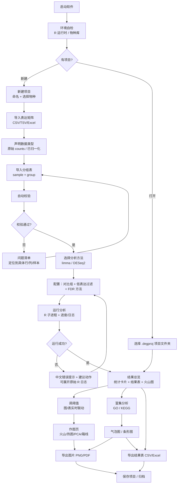
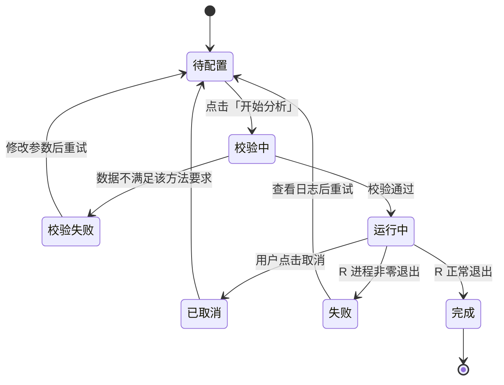

# PRD · DEG Studio — 生信差异表达分析桌面客户端

> 版本 v1.0 ｜ 阶段：需求定义 ｜ 撰写：产品经理 许清楚
> 面向对象：系统架构师、开发、测试

---

## 1. 项目信息

| 项 | 内容 |
|---|---|
| 文档语言 | 中文 |
| 技术栈基调 | Electron + React + MUI + Tailwind CSS（前端）；R 作为分析内核，通过**子进程**调用（架构细节由架构师细化） |
| Project Name | `deg_studio` |
| 产品形态 | Windows 桌面客户端，双击即用，本地离线分析 |
| 目标版本 | v1.0（MVP） |

### 原始需求复述

客户需要一款**给个人科研人员用的生信分析桌面软件**。用户在自己电脑上导入表达矩阵与样本分组信息，完成差异表达分析（limma / DESeq2）、可视化（火山图、热图、PCA、箱线图、富集气泡图/条形图）以及 GO / KEGG / GSEA 富集分析（clusterProfiler 流程），并能导出图片和表格。

关键硬约束：

1. **必须是桌面客户端**，不是 Web、不是 Shiny、不是纯 R 包。
2. **软件内置 R 运行时**（随安装包分发 R 及全部所需 R 包），用户**不需要**自己装 R、不需要联网配 Bioconductor。
3. 目标用户是**不写代码**的科研人员，易用性优先于功能广度。
4. 数据规模：表达矩阵约几千基因 × 几十个样本。

---

## 2. 产品目标

### 2.1 一句话定位

> **一款开箱即用的桌面级转录组差异分析工具：装好就能跑，不写一行代码，从导入数据到拿到可直接投稿的图和表，全程离线。**

### 2.2 成功标准（可衡量）

| # | 成功标准 | 验收方式 |
|---|---|---|
| S1 | **零环境配置**：安装包安装完成后，在**断网**状态下可 100% 完成 limma / DESeq2 差异分析 + 火山图 / 热图 / PCA / 箱线图 + GO 富集 + 结果导出；用户全程不需要打开命令行、不需要安装 R 或任何 R 包 | 在干净 Windows 机器上断网走完整流程，无阻断 |
| S2 | **上手成本**：新用户在不看文档的情况下，从导入数据到导出第一张火山图 ≤ 10 分钟；主链路（导入→分析→出图）界面点击次数 ≤ 8 次 | 3 名非 R 背景用户实测计时 |
| S3 | **结果正确性**：同一数据集下，本软件输出的 logFC / P.Value / adj.P.Val 与 R 命令行标准脚本（limma 用户指南、DESeq2 vignette 原版流程）结果**相对误差 < 1e-6**；火山图上的显著点数与结果表按同阈值筛选出的行数**完全一致** | 黄金数据集回归比对 |
| S4 | **规模性能**：5000 基因 × 48 样本矩阵，DESeq2 全流程（含低表达过滤）在 8 核 / 16GB 机器上 ≤ 120 秒；运行期间界面不卡死、进度可见、可取消 | 性能基准测试 |
| S5 | **出图质量**：所有图表默认导出 PNG **300 dpi**，单图导出 ≤ 3 秒；PDF 为矢量；图片在 Word / PPT 中插入后文字不糊 | 目视 + 分辨率检查 |

---

## 3. 目标用户与典型场景

### 画像 A：医学博士生 · 小林（首要用户）

- 28 岁，临床医学背景，课题是"肺癌 vs 癌旁组织的转录组差异"
- 刚拿到 24 例样本（12 肿瘤 / 12 癌旁）的 count 矩阵，导师要求"下周组会前出火山图和热图"
- 会 SPSS、会画 GraphPad，**完全不会 R**
- 痛点是：网上的教程第一步就是装 R、装 Bioconductor，报错看不懂；Cytoscape / TBtools 只能做一部分
- **典型场景**：晚上在自己 Windows 笔记本上，把 Excel 拖进软件，选 DESeq2，点运行，10 分钟后拿到火山图 + 热图 + 差异基因表，直接贴进组会 PPT

### 画像 B：青年 PI · 张老师

- 40 岁，课题组做肿瘤方向，带 3-5 个学生
- 会一点 R，但不想每次改脚本；需要反复调阈值出图用于投稿
- 关注：结果是否可信、图是否够清晰、参数是否可复现
- **典型场景**：拿到结果后反复对比 logFC = 1.0 / 1.5、FDR = 0.05 / 0.01 下的差异基因数，挑一套最合适的图导出给期刊；半年后要补一张图，打开项目还能看到当时用的所有参数

### 画像 C：医院中心实验室技术员 · 王工

- 负责帮临床医生跑分析，一周 2-3 个数据集，会被追问"这个结果怎么来的"
- 关注：别出错、能复现、能归档、出错时能定位
- **典型场景**：建项目 → 导入 → 跑 → 把整个项目文件夹拷给医生；出问题时要能导出 R 日志

---

## 4. 用户故事

| ID | 角色 | 用户故事 | 验收要点 |
|---|---|---|---|
| US-01 | 小林（博士生） | 作为不会写 R 的用户，我想把 CSV / Excel 表达矩阵和分组表**直接拖进窗口**，软件自动识别行列并告诉我哪里格式不对，这样我不用记"第一列必须是基因名"这类规则 | 拖拽可导入；格式问题定位到具体行/列/样本名 |
| US-02 | 小林 | 作为用户，我想在界面上选分析方法（limma / DESeq2）、选对比组（Tumor vs Normal）、开关低表达过滤，这样我不用改脚本 | 全部配置项可视化；选 DESeq2 但数据是小数时给出阻断提示 |
| US-03 | 张老师（PI） | 作为要判断结果可靠性的 PI，我想一眼看到差异基因总数、上调数、下调数，以及可排序可搜索的完整结果表 | 结果页顶部有 3 个统计卡片；表格支持排序、搜索、按显著性过滤 |
| US-04 | 张老师 | 作为要投稿的用户，我想**拖动 logFC / FDR 阈值滑块**，图和表实时同步更新，这样我能快速试不同阈值 | 拖滑块后 500ms 内图表与计数更新，无需重新跑 R |
| US-05 | 小林 | 作为要组会汇报的用户，我想一键生成火山图、热图、PCA、箱线图，能调颜色/标题/标注基因数，并导出 300dpi PNG 和 PDF | 4 类图均有参数面板；导出分辨率与尺寸可设 |
| US-06 | 小林 | 作为想解释生物学意义的用户，我想把差异基因直接送进 GO / KEGG 富集，看到气泡图和条形图，并能导出富集结果表 | 一键"用当前差异基因做富集"，无需手工复制基因列表 |
| US-07 | 张老师 | 作为想看通路整体趋势的用户，我想用全基因排序表跑 GSEA 并看到富集曲线（P1） | GSEA 结果含 NES、p.adjust、leading edge |
| US-08 | 王工（技术员） | 作为要交付报告的用户，我想把结果表导出 Excel、把整套图批量导出到一个文件夹、把项目保存成能重新打开的文件 | 批量导出一次生成全部图；项目文件双击可重开且参数完整 |
| US-09 | 全体 | 作为跑大数据的用户，我想看到进度条和 R 实时日志，能中途取消，出错时看到**人话**的错误提示而不是 R 报错堆栈 | 进度条 + 可取消；错误映射为中文 + 建议动作 + 可展开原始日志 |
| US-10 | 全体 | 作为怕环境出问题的用户，我想在首页看到"R 运行时正常 / 物种注释库已安装"，出问题时能一键自检 | 启动自检，首页显示环境状态灯 |

---

## 5. 需求池

优先级定义：**P0 = 第一版必须有（缺了产品不成立）**；**P1 = 第二版（体验补强）**；**P2 = 未来规划**。

### 5.1 P0（MVP 必须交付）

#### A. 项目与环境

| ID | 需求 | 验收标准 |
|---|---|---|
| R-01 | 项目创建 / 打开 / 自动保存。一个项目 = 一个 `.degproj` 文件夹，含数据副本、参数快照、结果、图 | 新建项目后可重开；重开后数据、参数、图、结果表完整还原；关闭前自动保存，异常退出后可恢复到上次成功步骤 |
| R-02 | **内置 R 运行时**及所需 R 包随安装包分发；启动时自检 | 干净机器断网可用；首页显示 `R 版本 / 必需包 / 物种库` 三项状态灯；缺失时给出中文修复提示 |
| R-03 | 软件数据全程不出本机 | 断网环境下所有本地分析功能可用（KEGG 富集除外，见 R-19） |

#### B. 数据导入与校验

| ID | 需求 | 验收标准 |
|---|---|---|
| R-04 | 表达矩阵导入：CSV / TSV / TXT / XLSX / XLS，支持拖拽 | 自动嗅探分隔符、表头、编码（UTF-8 → GB18030 回退）；导入后显示"基因数 × 样本数" |
| R-05 | 分组表导入：CSV / TSV / XLSX | 至少识别 `sample` 与 `group` 两列；支持用户手工指定哪列是样本、哪列是分组 |
| R-06 | 数据校验 | 覆盖：样本名集合一致性（列出差集清单）、重复基因名、重复样本名、非数值单元格、NA 比例、全零行、组别数 < 2、某组样本数 < 2；每条问题定位到具体行列并给出处理建议（详见 §8.3） |
| R-07 | 数据预览与手工修正 | 导入后展示前 100 行表格预览；允许手工指定"基因 ID 列"、修改分组标签、选择重复基因名聚合策略 |
| R-08 | 基因 ID 类型识别与转换 | 自动识别 SYMBOL / ENSEMBL / ENTREZ 并可在界面上转换；无法识别的 ID 数量给出提示 |

#### C. 差异表达分析

| ID | 需求 | 验收标准 |
|---|---|---|
| R-09 | **limma** 差异分析：counts 走 `voom`；已归一化表达走 `log2 + lmFit` | 结果与 limma 用户指南标准脚本一致（误差 < 1e-6） |
| R-10 | **DESeq2** 差异分析 | 要求非负整数 counts；检测到小数或负数时阻断并建议改用 limma+voom；结果与 DESeq2 vignette 一致 |
| R-11 | 低表达过滤（可开关、阈值可调） | 默认 `filterByExpr`；支持自定义"表达量 ≥ X 且在 ≥ Y% 样本中检出"；界面显示过滤前后基因数 |
| R-12 | 对比组设置 | 多组时可选任意两组做 contrast，支持方向切换（A vs B ⇄ B vs A），并明确标注"logFC > 0 表示在哪个组上调" |
| R-13 | 结果表字段完整 | 至少包含：`gene_id, gene_name, logFC, AveExpr(baseMean), t(stat), P.Value, adj.P.Val, B, regulation(↑/↓/—)` |
| R-14 | 物种支持 Human / Mouse（内置 `org.Hs.eg.db`、`org.Mm.eg.db`） | 两个物种的差异分析与 GO 富集均可离线跑通 |

#### D. 可视化

| ID | 需求 | 验收标准 |
|---|---|---|
| R-15 | 阈值筛选：logFC 阈值 + FDR 阈值，可输入可拖动，**图表与结果表联动** | 调整后 500ms 内更新；火山图显著点数 == 结果表筛选行数（严格相等） |
| R-16 | **火山图**：x = logFC，y = -log10(P)，阈值虚线，上调/下调/不显著三色，可标注 Top N 基因名 | 可调 logFC/FDR 阈值、Top N、点大小、配色；导出 PNG 300dpi / PDF |
| R-17 | **PCA 图**：默认取 Top 500 高变基因，显示 PC1/PC2 轴标签含方差解释比例，样本按组着色 | 轴标签形如 `PC1 (42.3%)`；可切换 PC 对；可导出 |
| R-18 | **热图**：Top N 差异基因，行 z-score，行/列聚类可开关，顶部带分组注释色条 | 可调 Top N（默认 50）、聚类方法与距离、配色；导出 PNG ≥ 300dpi / PDF |
| R-19 | **箱线图**：① 指定基因在各组间的表达箱线图（叠加散点）；② 全样本表达分布 QC 图 | 可搜索基因名；可多基因切换；导出同上 |
| R-20 | 富集可视化：**气泡图 + 条形图** | 可调 Top N 条目（默认 20）、颜色映射（p.adjust）、大小映射（Count）、是否显示基因名；导出同上 |

#### E. 富集分析

| ID | 需求 | 验收标准 |
|---|---|---|
| R-21 | **GO 富集**（`enrichGO`，BP / CC / MF 可多选） | 完全离线可用；输出标准 9 列结果表；可多本体同时出图 |
| R-22 | **KEGG 富集**（`enrichKEGG`） | 明确提示"KEGG 需联网获取通路数据"；联网时可用；断网时给出明确文案而非 R 报错（离线缓存方案见 P1） |
| R-23 | 富集结果表字段 | `ID, Description, GeneRatio, BgRatio, pvalue, p.adjust, qvalue, geneID, Count` |
| R-24 | 富集输入方式 | 默认"使用当前阈值下的差异基因"；支持上调/下调/全部分别分析；支持手动粘贴基因列表 |

#### F. 导出与归档

| ID | 需求 | 验收标准 |
|---|---|---|
| R-25 | 结果表导出 CSV / Excel（差异表、富集表） | 中文不乱码；列顺序与界面一致；仅导出当前筛选结果或全量可切换 |
| R-26 | 单图导出 PNG（默认 300dpi，可设宽高与 DPI）/ PDF（矢量） | 单图导出 ≤ 3 秒；PDF 放大不失真 |
| R-27 | 批量导出当前分析的全部图表到指定文件夹 | 一次生成全部图，文件名含图表类型与分析对比名 |

#### G. 任务与错误处理

| ID | 需求 | 验收标准 |
|---|---|---|
| R-28 | 长任务进度条 + 实时 R 日志面板 + 可取消 | 进度分阶段显示（读数据 → 过滤 → 拟合 → 检验）；取消后 R 子进程被真正终止，不留僵尸进程 |
| R-29 | 错误翻译：常见 R 错误映射为中文提示 + 建议动作 + 可展开原始日志 | 至少覆盖：内存不足、数据非整数、样本名不匹配、包加载失败、基因 ID 无法映射、KEGG 无网络 |
| R-30 | 中文界面，中文图表标签正常显示（无方框乱码） | Windows 默认环境出图中文不乱码 |

### 5.2 P1（第二版）

| ID | 需求 | 说明 |
|---|---|---|
| P1-01 | **GSEA**（`gseGO` / `gseKEGG`）+ 富集曲线图 | 输入为全基因排序表（按 logFC 或 stat 排序），输出 NES / p.adjust / leading edge |
| P1-02 | 自定义基因集导入（GMT） | 支持用户自己的通路集合做 GSEA / ORA |
| P1-03 | 批次与协变量校正 | limma 设计矩阵支持 `~ batch + group`；或提供 ComBat 选项 |
| P1-04 | 更多物种 | 大鼠、斑马鱼、酵母、拟南芥等（按需下载注释包） |
| P1-05 | 多对比组批量运行 | 一次配置多个 contrast，批量出结果与图 |
| P1-06 | 图表样式模板保存与复用 | 存配色/字号/尺寸，跨项目套用 |
| P1-07 | SVG 导出 | 除 PNG / PDF 外增加矢量 SVG |
| P1-08 | KEGG 结果本地缓存 | 首次联网拉取后缓存到本地，之后可离线复跑 |
| P1-09 | 分析快照对比 | 保留多次运行结果，可对比不同参数下的差异基因重叠（Venn / UpSet） |
| P1-10 | 一键生成汇总报告 | 导出 HTML 或 Word，含参数、图、结果表 |
| P1-11 | 芯片（已归一化）数据专用通道 | 针对非 counts 数据的引导式流程与提示 |

### 5.3 P2（未来）

| ID | 需求 |
|---|---|
| P2-01 | 其他组学支持（蛋白组、代谢组） |
| P2-02 | PPI 网络 / WGCNA / 免疫浸润等扩展分析 |
| P2-03 | 云端项目同步与分享链接 |
| P2-04 | 命令行 / 批处理模式（供高级用户脚本化） |
| P2-05 | 英文界面（i18n） |
| P2-06 | 插件式分析模块（第三方扩展） |

---

## 6. 核心流程设计

### 6.1 主流程（从打开软件到拿到图和表）



### 6.2 分析任务状态机



### 6.3 项目产物结构（供架构参考）

```
<项目名>.degproj/
├── project.json        # 项目元信息、参数快照、状态、软件版本
├── data/               # 导入数据的本地副本（原始 + 清洗后）
├── results/
│   ├── de/             # 差异分析结果表
│   └── enrich/         # GO / KEGG 富集结果表
├── figures/            # 已导出的图
└── logs/               # 每次运行的 R 日志
```

> 设计意图：项目自包含，可直接拷给同事或归档，重开时无需原始数据文件。

---

## 7. UI 设计稿（ASCII 线框图）

全局框架：左侧无固定侧栏（避免遮挡画布），采用**顶部步骤条 + 主内容区 + 底部状态栏**。主链路四个页面用步骤条串联：`数据 → 分析 → 结果 → 作图/富集`。

### 7.1 S1 · 首页 / 项目列表

```
┌─ 首页 · 项目列表 ─────────────────────────────────────────────────────
│
│  DEG Studio                                     R 4.3.2 内置 ● 正常
│  ──────────────────────────────────────────────────────────────────
│
│   [ ＋ 新建项目 ]     [ 打开项目… ]     [ 载入示例数据 ]
│
│  最近项目
│  ┌──────────────────────────────────────────────────────────────
│  │ 名称              物种    最后修改       状态       操作
│  ├──────────────────────────────────────────────────────────────
│  │ 肺癌_vs_癌旁      Human   06-12 10:22   已完成     [打开] [⋯]
│  │ 肝_处理组         Mouse   06-10 09:01   分析中断   [打开] [⋯]
│  │ 乳腺_预实验       Human   06-03 15:40   仅导入     [打开] [⋯]
│  └──────────────────────────────────────────────────────────────
│
│  环境自检  R 运行时 ●  物种注释库 Human/Mouse ●  磁盘占用 1.8 GB
│                                                [ 运行诊断 ]
└──────────────────────────────────────────────────────────────────────
```

关键控件与交互：

- 「新建项目」→ 弹窗输入项目名 + 选择物种（Human / Mouse）+ 选择保存路径
- 「载入示例数据」→ 一键载入内置的 24 样本 demo 数据集，用于教学和首次体验
- 最近项目列表：单击行打开；`⋯` 菜单含「在文件夹中显示 / 复制项目 / 删除」
- 状态列取值：`仅导入 / 分析中断 / 已完成`
- 环境自检行：任一红灯可点「运行诊断」，弹出诊断面板（R 版本、包清单、缺失项、修复建议）

### 7.2 S2 · 数据导入向导

三步向导：`① 表达矩阵 → ② 分组信息 → ③ 校验通过`

```
┌─ 新建项目 · 数据导入 ────────────────────────────────────────────────
│
│   ① 表达矩阵 ────── ② 分组信息 ────── ③ 校验通过
│      ●                 ○                  ○
│
│  ┌─ 步骤 ①：导入表达矩阵 ────────────────────────────────────────
│  │
│  │   ┌────────────────────────────────────────────────────────┐
│  │   │                                                        │
│  │   │        把 CSV / TSV / Excel 文件拖到这里               │
│  │   │              或  [ 选择文件… ]                         │
│  │   │                                                        │
│  │   └────────────────────────────────────────────────────────┘
│  │
│  │  数据类型   ( ● ) 原始 counts（推荐 DESeq2）
│  │             (   ) 已归一化表达（TPM / FPKM / log2，走 limma）
│  │
│  │  物种 [ Human ▾ ]      基因 ID 类型 [ 自动识别 ▾ ]  → 识别为 SYMBOL
│  │
│  │  预览（前 10 行 × 前 6 列）            [ 指定基因 ID 列 ▾ ]
│  │  ┌────────────────────────────────────────────────────────┐
│  │  │ gene_id    S01    S02    S03    S04    S05    S06      │
│  │  │ TP53       1024   987    1130   45     890    760      │
│  │  │ EGFR       12     8      0      3      15     9        │
│  │  └────────────────────────────────────────────────────────┘
│  │
│  │  ⓘ 识别结果：5,432 个基因 × 48 个样本 ｜ 未发现重复基因名
│  │
│  └────────────────────────────────────────────────────────────
│
│                                         [ 上一步 ]  [ 下一步 → ]
└──────────────────────────────────────────────────────────────────────
```

关键控件与交互：

- 拖拽区高亮反馈；导入后立即显示识别摘要
- 「数据类型」决定后续可选方法：选 counts → DESeq2 可用；选已归一化 → DESeq2 置灰并提示原因
- 「指定基因 ID 列」应对自动识别失败（比如第一列是探针 ID 或存在注释列）
- 预览表格固定表头，横向可滚动
- 有阻断问题时「下一步」置灰，并显示问题数徽标

### 7.3 S3 · 差异分析配置页

```
┌─ 差异表达分析 · 配置 ────────────────────────────────────────────────
│
│  分析方法   ( ● ) limma + voom          (   ) limma（已归一化数据）
│             (   ) DESeq2                ⓘ DESeq2 需要非负整数 counts
│
│  对比组    分组列 [ group ▾ ]
│            实验组 [ Tumor ▾ ]      对照（基线） [ Normal ▾ ]   ⇄ 交换
│            ⓘ logFC > 0 表示该基因在 Tumor 中上调
│
│  低表达过滤  [✓] 开启
│             ( ● ) filterByExpr（自动）      (   ) 自定义
│             自定义：表达量 ≥ [ 10 ]，且在 ≥ [ 50 ] % 样本中检出
│
│  多重检验  FDR 校正 [ Benjamini-Hochberg ▾ ]
│
│  高级选项  [✓] 输出基因名映射   [ ] 保留全部基因（不过滤）
│
│  ── 数据检查 ───────────────────────────────────────────────────────
│   ✓ 表达矩阵 5,432 基因 × 48 样本
│   ✓ 分组表 48 行，2 组（Tumor 24 / Normal 24）
│   ✓ 样本名完全匹配
│   ✓ counts 全为非负整数
│   ⚠ 检出 312 个基因在所有样本中为 0，将被自动过滤
│
│                                          [ 重置 ]   [ ▶ 开始分析 ]
└──────────────────────────────────────────────────────────────────────
```

关键控件与交互：

- 方法单选卡片：不可用的方法置灰 + hover 显示原因（而非静默隐藏，用户需要知道为什么）
- 对比组方向切换 `⇄` 会翻转 logFC 符号，界面上必须显式提示语义
- 数据检查区为**运行前预检**，错误级（红）阻断「开始分析」，警告级（黄）允许继续
- 点击「开始分析」→ 页面切换为运行态（见 S7）

### 7.4 S4 · 结果总览页

```
┌─ 结果总览 · Tumor vs Normal ─────────────────────────────────────────
│  方法 DESeq2 ｜ 过滤后 5,120 基因 ｜ 耗时 86s ｜ [ 查看日志 ]
├──────────────────────────────────────────────────────────────────────
│  ┌ 差异基因 ┐ ┌ 上调 ──┐ ┌ 下调 ──┐ ┌ 当前阈值 ────────────────┐
│  │  1,284   │ │  702   │ │  582   │ │ logFC ≥ 1.0  FDR < 0.05  │
│  └──────────┘ └────────┘ └────────┘ └──────────────────────────┘
│
│  阈值   logFC |━━━━━━━●━━━━━━━|  1.0     FDR |━━━●━━━━━━━━━━|  0.05
│
│  ┌ 火山图 ──────────────────────────────┐ ┌ 图例 ───────────────┐
│  │                        ●             │ │ ● 上调 702          │
│  │                 ●   ●  ● ●           │ │ ● 下调 582          │
│  │       ●     ●  ●  ● ●  ●             │ │ ● 不显著 3,836      │
│  │  ────────────●──────────────────     │ │                     │
│  │    ●   ●  ●      ●    ●              │ │ 标注 Top [ 10 ▾ ]   │
│  │  ●       ●   ●                       │ │ [PNG] [PDF] [⋯]     │
│  └──────────────────────────────────────┘ └─────────────────────┘
│
│  ┌ 结果表 ───────────────────────────────────────────────────────
│  │ 搜索基因…          [✓ 仅显示显著]     [导出 CSV] [导出 Excel]
│  │ gene    logFC   AveExpr   P.Value   FDR       B      标记
│  │ TP53     3.42    8.91     1.2e-15   4.1e-13   42.1    ↑
│  │ EGFR    -2.87    7.20     3.4e-12   2.9e-10   35.6    ↓
│  └───────────────────────────────────────────────────────────────
│
│  [ 去作图 ]    [ 去做富集分析 ]    [ 保存项目 ]
└──────────────────────────────────────────────────────────────────────
```

关键控件与交互：

- 三个统计卡片随阈值滑块实时变化（**纯前端重算，不重跑 R**）
- 火山图与结果表共享同一筛选状态，双向一致
- 表格支持按任意列排序、按基因名搜索、点击行高亮对应火山图点（hover 联动）
- 顶部「查看日志」打开 S7 日志抽屉

### 7.5 S5 · 作图页

```
┌─ 作图 ───────────────────────────────────────────────────────────────
│  图表类型  [ 火山图 ] [ 热图 ] [ PCA ] [ 箱线图 ] [ 富集图 ]
├──────────────────────────────────┬───────────────────────────────────
│  画布                            │  参数
│  ┌────────────────────────────┐  │  ── 通用 ────────────────────
│  │                            │  │  标题    [ Tumor vs Normal ]
│  │          ●                 │  │  配色    [ 红-蓝 ▾ ]
│  │      ●       ●  ●          │  │  字号    [ 12 ]
│  │  ────────●───────────      │  │  图宽    [ 8 ] in  高 [ 6 ] in
│  │        ●  ●    ●           │  │  导出    [✓] PNG 300dpi  [ ] PDF
│  │                            │  │
│  │                            │  │  ── 火山图参数 ──────────────
│  └────────────────────────────┘  │  logFC 阈值   [ 1.0 ]
│                                  │  FDR 阈值     [ 0.05 ]
│  [ ⟲ 重绘 ]   [ ⤢ 全屏 ]          │  标注 Top N   [ 10 ]
│                                  │  显示基因名   [✓]
│                                  │  点大小       [ 1.6 ]
│                                  │
│                                  │  [ 导出当前图 ]  [ 全部导出 ]
└──────────────────────────────────┴───────────────────────────────────
```

关键控件与交互：

- 左侧画布为**所见即所得预览**，参数改动后 300ms 防抖自动重绘
- 切换图表类型时右侧参数面板联动切换（通用参数保留）
- 各图表类型专属参数：
  - 热图：Top N（默认 50）、行 z-score（默认开）、行/列聚类开关、聚类方法、分组注释条开关
  - PCA：使用基因数（默认 Top 500 高变）、PC 对选择、是否加置信椭圆
  - 箱线图：基因搜索选择器、是否叠加散点、是否 log 纵轴
- 「全部导出」一次导出当前分析涉及的所有图表

### 7.6 S6 · 富集分析页

```
┌─ 富集分析 ───────────────────────────────────────────────────────────
│  输入基因   ( ● ) 当前阈值的差异基因（1,284 个｜上调 702 / 下调 582）
│             (   ) 手动粘贴基因列表        (   ) 指定基因集文件（GMT）
│  分析类型   [✓] GO      [✓] KEGG      [ ] GSEA（v1.1 提供）
│  GO 本体    [✓] BP   [✓] CC   [✓] MF
│  物种注释   Human (org.Hs.eg.db) ● 已内置        KEGG ● 需联网
├──────────────────────────────────────────────────────────────────────
│  ┌ 气泡图 ────────────────────────────┐ ┌ 条形图 ─────────────────┐
│  │  cell cycle          ○             │ │ cell cycle     ████  42 │
│  │  DNA replication       ○           │ │ DNA repl.      ███   31 │
│  │  p53 signaling            ○        │ │ p53 path.      ██    24 │
│  │    0.02   0.04   0.06   p.adjust   │ │               0  20  40 │
│  └────────────────────────────────────┘ └─────────────────────────┘
│
│  ┌ 富集结果表 ─────────────────────────────────────────────────────
│  │ 来源 [ GO:BP ▾ ]   排序 [ p.adjust ▾ ]    [导出 CSV] [导出 Excel]
│  │ ID           Description        GeneRatio   p.adjust   Count
│  │ GO:0007049   cell cycle         42/1284     1.2e-08    42
│  │ GO:0006260   DNA replication    31/1284     4.5e-07    31
│  └─────────────────────────────────────────────────────────────────
└──────────────────────────────────────────────────────────────────────
```

关键控件与交互：

- 默认输入为"当前阈值下的差异基因"，与 S4 的阈值状态联动（改了阈值，富集需重新点击「运行富集」）
- 支持按上/下调分别富集（生物意义上调下调通路往往不同）
- KEGG 断网时：按钮仍可点，但点击后弹中文说明「KEGG 通路数据需联网获取，请连接网络后重试」，并保留 GO 可用
- 气泡图/条形图的 Top N 与排序方式可切换（按 p.adjust / Count）

### 7.7 S7 · 运行态 / 日志抽屉（叠加层）

```
┌─ 运行中 · DESeq2 ────────────────────────────────────────────────────
│   [███████████████████░░░░░░░░░░░░░░░]  62%
│   正在估计离散度（estimateDispersions）…      00:53 已用 / 约 01:26
│                                                    [ 取消 ]
├─ 日志 ───────────────────────────────────────────────────────────────
│ [10:22:01] 读取表达矩阵 5,432 × 48
│ [10:22:02] 过滤低表达基因 → 5,120
│ [10:22:03] DESeqDataSetFromMatrix 构建成功
│ [10:22:18] estimateSizeFactors 完成
│ [10:23:02] estimateDispersions 进行中 …
└──────────────────────────────────────────────────────────────────────
```

关键控件与交互：

- 阶段化进度（读数据 → 过滤 → 归一化 → 离散度估计 → 模型拟合 → 检验），每阶段完成时前进
- 「取消」二次确认，取消后 R 子进程必须被真正 kill
- 日志区自动滚动到底部，可复制全文（便于用户求助时贴给他人）

---

## 8. 数据格式约定

### 8.1 表达矩阵

| 项 | 约定 |
|---|---|
| 文件格式 | `.csv` / `.tsv` / `.txt` / `.xlsx` / `.xls` |
| 编码 | 优先 UTF-8，失败回退 GB18030；仍失败提示另存为 UTF-8 |
| 结构 | **行 = 基因，列 = 样本**（第一列必须为基因 ID 列） |
| 首行 | 表头；第一个单元格可为空或为 `gene_id` / `Gene` / `ID` 等，自动识别 |
| 基因 ID | 支持 SYMBOL（`TP53`）、ENSEMBL（`ENSG00000141510`）、ENTREZ（`7157`）；自动识别 |
| 重复基因名 | **不允许静默保留**。弹出选择：取均值 / 求和 / 保留最大表达 / 保留第一条 |
| 缺失值 | 允许 `NA` / 空 / `NaN`；NA 比例 > 20% 时给出警告 |
| counts 要求 | DESeq2 路径下必须为**非负整数**；小数或负数 → 阻断并建议 limma+voom |
| 全零行 | 允许存在，自动过滤并告知数量 |
| 行数上限（软） | 建议 ≤ 60,000 基因；超过时提示可能内存不足 |

示例：

```csv
gene_id,S01,S02,S03,S04
TP53,1024,987,1130,45
EGFR,12,8,0,3
```

### 8.2 分组表

| 项 | 约定 |
|---|---|
| 文件格式 | `.csv` / `.tsv` / `.xlsx` |
| 必需列 | 样本列（默认识别 `sample` / `Sample` / `样本`）+ 分组列（默认识别 `group` / `Group` / `分组`） |
| 样本名匹配 | 与矩阵列名**去首尾空格后必须完全一致**（大小写敏感）；不匹配时列出差集并支持"自动取交集" |
| 组别数 | ≥ 2；某组样本数 < 2 阻断，= 2 给警告（建议 ≥ 3） |
| 可选列 | `batch`（P1 协变量校正用）、`pair`（配对样本，P1） |
| 额外行 | 允许多余样本行，但必须提示"分组表中有 N 个样本在矩阵中不存在" |

示例：

```csv
sample,group
S01,Tumor
S02,Tumor
S03,Normal
S04,Normal
```

### 8.3 常见格式错误提示策略

| 错误类型 | 检测时机 | 提示文案（示例） | 级别 |
|---|---|---|---|
| 样本名不匹配 | 导入分组表后 | 「分组表中有 3 个样本在矩阵中找不到：S49、S50、S51；矩阵中有 2 个样本未分组：S12、S13」+ 提供「自动取交集」 | 阻断 |
| 分组列只有 1 个取值 | 导入分组表后 | 「分组列 `group` 只检测到 1 个取值（Tumor），差异分析至少需要 2 组」 | 阻断 |
| 某组样本数 < 2 | 校验 | 「组 `Normal` 只有 1 个样本，无法估计组内方差」 | 阻断 |
| 某组样本数 = 2 | 校验 | 「组 `Normal` 只有 2 个样本，统计功效较低，建议每组 ≥ 3」 | 警告 |
| 重复基因名 | 解析矩阵 | 「发现 42 个重复基因名，请选择聚合方式」+ 4 个选项 | 阻断（需选择） |
| 重复样本名 | 解析矩阵 | 「列名 S03 出现 2 次，请检查表头」 | 阻断 |
| 非数值单元格 | 解析矩阵 | 「第 4 列 S03 第 128 行为 `NA_1`，已按缺失处理」 | 警告 |
| counts 含小数/负数 | 选择 DESeq2 时 | 「检测到表达值含小数（如 12.4），DESeq2 需要原始整数 counts。建议改用 limma+voom」 | 阻断 |
| 全零基因 | 校验 | 「312 个基因在所有样本中为 0，将被自动过滤」 | 警告 |
| NA 比例过高 | 校验 | 「基因 TP53 在 60% 样本中为缺失，建议过滤」 | 警告 |
| 文件编码无法识别 | 解析 | 「文件编码无法识别，请在 Excel 中另存为 UTF-8 CSV 后重试」 | 阻断 |
| 矩阵为空 / 只有 1 列 | 解析 | 「未识别到有效数据列，请确认第一列为基因 ID、其后为各样本」 | 阻断 |
| 内存风险 | 运行前 | 「矩阵规模 20,000 × 200，预计占用 6 GB 内存，当前可用 4 GB」 | 警告 |
| KEGG 无网络 | 点击运行富集 | 「KEGG 通路数据需联网获取，请连接网络后重试（GO 富集可正常使用）」 | 阻断（仅该功能） |

**提示文案总原则**：说清"哪里错了 + 为什么错 + 该怎么办"，禁止直接抛 R 报错；原始 R 日志始终可在「展开详情」中查看。

---

## 9. 非功能性约束（提示架构师注意）

| 项 | 约束 |
|---|---|
| 安装包体积 | 内置 R + Bioconductor 包后预计 **1.5–2.5 GB**，安装后占用更大。需在安装向导与官网明确告知用户，避免"这么大是不是有病毒"的疑虑 |
| 平台 | **Windows 10/11 x64 优先**；macOS 版本排期待定 |
| 离线能力 | 除 KEGG 富集外，全部功能断网可用 |
| 数据隐私 | 所有数据仅在本机处理，不上传；界面需明确标注这一点 |
| 中文渲染 | 图表中文标签在 Windows 默认字体环境下不得出现方框/乱码 |
| 进程管理 | R 子进程必须可被可靠终止；软件退出时清理所有子进程 |
| 单文件上限 | 建议矩阵文件 ≤ 200 MB（超出时提示并允许尝试） |

---

## 10. 待确认问题

| # | 问题 | 影响 | 我的建议默认值 |
|---|---|---|---|
| Q1 | **KEGG 富集需要联网**（clusterProfiler 走 KEGG REST API），与"全程离线"存在冲突。是否接受"仅 KEGG 首次需联网"，或要求 v1.0 就内置离线通路快照？ | 影响 P0 范围与安装包体积 | 建议 v1.0 接受"KEGG 需联网"，离线缓存放 P1 |
| Q2 | **GSEA 是否必须进 v1.0**？客户原始需求列了 GSEA，但 GSEA 需要全基因排序表、参数更多（基因集、权重、置换次数），会显著增加 v1.0 复杂度 | 影响 MVP 工期 | 建议放 P1，v1.0 先做 ORA（GO/KEGG） |
| Q3 | 图片导出的**格式与分辨率**是否有硬性要求（期刊常要 300/600 dpi TIFF、或矢量 EPS）？是否需要 TIFF/EPS？ | 影响导出模块 | 建议 v1.0 支持 PNG 300dpi + PDF，TIFF/EPS 按需加 |
| Q4 | 是否需要**中英双语界面**？图表标签用中文还是英文？ | 影响 i18n 架构与出图 | 建议 v1.0 纯中文界面、图表标签中文；英文放 P2 |
| Q5 | **物种范围**：v1.0 只做 Human + Mouse 是否够？客户的课题组是否有植物/其他模式生物需求？ | 影响内置注释包体积（每个物种约 100-300 MB） | 建议 v1.0 Human + Mouse，其余 P1 按需下载 |
| Q6 | 是否需要**一键生成汇总报告**（HTML/Word，含参数+图+表）？这是交付给医生/导师的高频诉求 | 影响 v1.0 交付完整度 | 建议 P1 |
| Q7 | 是否需要支持**配对样本 / 批次协变量**？临床样本常带批次 | 影响设计矩阵与配置界面复杂度 | 建议 P1（v1.0 界面预留 batch 列位但不参与建模） |
| Q8 | **macOS 版本**是否需要？若需要，排期与 Windows 是否同期？ | 影响打包与 R 运行时分发方案 | 建议 v1.0 仅 Windows，macOS 二期 |
| Q9 | 客户是否有**黄金数据集**（已知结论的公开数据集）可用于结果正确性回归验证？ | 影响 S3 验收能否落地 | 建议客户提供，或用 GEO 公开数据集（如 GSE 肺癌数据）替代 |
| Q10 | 是否需要**多对比组批量运行**（3 组以上一次跑全部两两对比）？ | 影响结果页组织方式 | 建议 P1 |
| Q11 | 安装包 1.5–2.5 GB 的体积，客户与最终用户是否可接受？是否需要提供"精简版 + 按需下载物种包"？ | 影响分发策略 | 建议 v1.0 单一全量包，降低用户操作成本 |
| Q12 | 用户是否可能导入**芯片数据（已归一化、非 counts）**？这类数据在医学领域很常见 | 影响 limma 通道的引导设计 | 建议 v1.0 支持（limma 通道已覆盖），但需单独的引导文案与 P1-11 的专用流程 |

---

## 11. 优先级判断摘要（给架构师的三句话）

1. **最关键的 3 件事**：① 数据导入 + 校验的健壮性（决定用户"能不能用起来"，80% 的放弃发生在这里）；② 内置 R 运行时 + 长任务/错误处理（决定"开箱即用"这个核心卖点是否成立）；③ 差异分析 → 阈值联动 → 出图这条主链路的**正确性与前后一致性**（决定产品是否可信）。
2. **架构上最需要预留弹性的地方**：分析方法的可插拔（limma/DESeq2 → 未来 GSEA/其他组学）、图表参数的可序列化（项目重开要还原）、R 子进程的生命周期管理（进度/取消/清理）。
3. **最容易被低估的成本**：内置 R 环境的打包与跨机器兼容（路径、字体、依赖库）、中文图表渲染、以及 KEGG 联网与"全程离线"承诺之间的语义冲突（需在产品文案上明确处理）。
